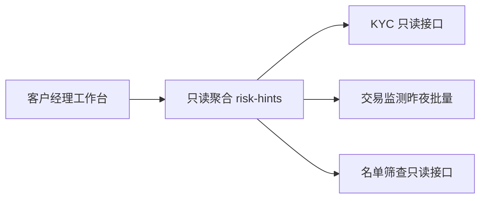

# 把一句话拆成可交付方案：接口、数据与集成

**FDE-03** · **2026-11-04** · Day 3 · **主题板块** 技术落地 · **难度** 入门

## 场景

虚拟银行的项目讨论里，项目经理说了一句：「能不能让客户经理一眼看到这个客户有没有风险。」

房间里都点了头。客户经理想的是谈话前扫一眼，合规想的是不要把不该看的明细放出来，做前端的人已经在画一颗红点。同一句话，三套系统。

公开面经里的常见问法是：先把模糊需求澄清（谁用、看什么、怎样算成功），再画接口、数据和集成。面试官会中途加上约束，例如数据放在哪、谁有权看、预算只够读现成接口。香港银行或保险的 FDE 岗位几乎没有公开逐字面经。下面仍用这句风险提示做教学案例，对得上这种拆解，不是某家银行的题目原文。

## 概念

一句话先澄清，再拆成四格，然后才画图。图只有三块：**接口、数据、集成**。来源还不知道的字段写成「待确认」，不为了画面完整编一个数。澄清没做完就画 API，画出来的是房间里声音最大的那个人的想象。

| 四格 | 要写清的事 |
|------|------------|
| 谁用 | 哪个角色、在哪个界面、客户本人看不看得到 |
| 看什么 | 哪几条已经存在的事实；谁都不拥有的分数就不要 |
| 从哪来 | 每条事实的系统；没有系统，就没有这条事实 |
| 何时算数 | 调用当时、昨夜批量，还是上一班；新鲜度写在返回里 |

三块图各管一件事：

- **接口**：谁调用，返回哪几个字段，不返回什么。失败和「没有标记」必须是两种结果。
- **数据**：每个字段的来源、空值的含义、刷新节奏。
- **集成**：走现有只读接口，还是去连库。图上没画的系统，这一版不连接。权限不够的字段，这一版不返回。

前端卡片放在图之后。卡片会逼出画面上的一个颜色；图会把「没有人拥有这个字段」露出来。

## 香港落地例子

同一句「客户经理要看到风险提示」，收成工作台上的一版只读聚合。教学例子，不代表任何一家虚拟银行的真实规则或阈值。大额与否沿用交易监测系统已有的标记，工作台不另定一条金额线。

先填四格：

| 四格 | 这一版的答案 |
|------|----------------|
| 谁用 | 客户经理，在自己的工作台。不出现在客户的 App |
| 看什么 | 三件已有事实：KYC 待复核、近 7 日大额异常标记、名单筛查命中。没有综合风险分 |
| 从哪来 | KYC 只读接口、名单筛查只读接口、交易监测的昨夜批量文件 |
| 何时算数 | 两个接口是调用当时；大额标记截至昨夜。今天白天的新交易不在这一版 |

再画集成。工作台只调用自己的只读聚合，聚合再调现成来源：

图上没有核心账数据库，没有「放行 / 拦截」按钮。没画出来的，这一版就不接。若面试官中途加上「数据必须留在客户的网络里」或「这个角色不能看名单明细」，就改集成和返回字段，不先改画面上的红点。

字段就这三行：

| 返回字段 | 来源 | 空着表示 | 失败表示 | 新鲜度 |
|----------|------|----------|----------|--------|
| kyc_pending | KYC 只读接口 | 没有待复核 | 这一项未知 | 调用当时 |
| large_txn_flag | 交易监测昨夜批量 | 昨夜批次里没有标记 | 文件没到，未知 | 截至昨夜 |
| screening_hit | 名单筛查只读接口 | 没有命中 | 这一项未知 | 随筛查系统自己的批次，工作台不重跑筛查 |

空值和失败不能画成同一种灰。未知若显示成「无风险」，演示当天就会替监测系统做结论。

用一个脱敏客户走一遍。客户经理打开工作台，聚合同时问三处：KYC 返回「待复核」，昨夜文件返回「无标记」，筛查超时。画面应是三行：待复核、截至昨夜无大额标记、筛查未知。超时若画成灰色的「无命中」，客户经理会告诉客户「名单没问题」。那是方案把失败画成了结论，不是文案没写好。

这一张图还不是范围确认。范围要另写：边界、不做、哪一天由谁点头。那是交付沟通的事。本课先把「做得出什么」画清楚。

同一句「一眼看到」换一家公司，落笔前要澄清的名词不同：

| 公司类别 | 先澄清的那一句 | 这一版的图上有什么 |
|----------|----------------|--------------------|
| 物流 | 「卡在哪」指仓库扫描、承运节点，还是清关回执 | 三类现有查询；不编一个推测地点 |
| 公营柜面 | 「取消了」要对上 App 状态，还是早上的叫号纸 | 状态和新鲜度；不改另一个部门的夜间叫号 |
| AI 产品 / 解决方案公司 | 谁用、成功看什么、中途加上的驻留或权限约束是哪一条 | 先有能演示的读接口；画面上的结论放在字段定了之后 |

## 面试怎么说

大约一分钟：

> “Before I draw the API, I clarify the sentence. Who uses it, which facts already exist, how fresh they are, and who is allowed to see them. At a virtual bank I would return three read-only risk hints and keep last night’s batch distinct from a failed call. I would not invent a risk score to feed a red dot, and I would not connect the core ledger in this version. If you add a constraint midway — residency, budget, or permissions — I change the integration, not the color on the screen.”

现场对客户经理或合规，用对方听得见的话确认「看哪三行、客户 App 上看不见、超时是未知」。方案和字段表用英文写，避免中文口头的「一眼」在邮件里又变成实时。

## 小练习

把这句话拆成三行，分别对应接口、数据、集成：

「物流客服想知道这票货现在卡在哪。」

已知只有这些：仓库有扫描，承运商有节点，清关每天两班回执。没有别的定位设备。

## 自测

1. 为什么听到「看风险」不能直接做一颗前端红点？
2. 面试官说「先画一版接口」。对方若来自虚拟银行、物流公司、公营柜面，或 AI 产品公司，你在落笔前要澄清的那一句有什么不同？

先写完再打开。

参考答案

### 小练习

一种合格写法：

- **接口**：`GET /shipments/{waybill}/blockers`，返回当前卡点、所在环节、最后一次状态时间。不返回「预计一定送达」。
- **数据**：只取仓库扫描、承运商节点、清关回执。某一类没有新记录，就返回「该环节无更新」，不补一个推测地点。
- **集成**：只读聚合这三类现有查询。不改承运商轨迹；清关按每天两班，返回里写明「截至上一班」。

三行里要同时出现：查什么、不编什么、数据截至何时。只写「做一个物流跟踪接口」不算拆完。落笔前已经澄清：没有定位设备，所以图上不出现实时坐标。

### 自测 1

红点会逼你发明一个画面上必须有的结论。房间里没有系统拥有「综合风险分」时，前端仍会做出一颗颜色，演示时每个人都以为别人对这个颜色负责。

先澄清四格再画图，缺口会露在纸上：今天的新交易不在昨夜批量里，核心账这一版不连接，空值和接口失败不是同一种结果。卡片是图定了之后的界面，不是用来发现缺口的。

### 自测 2

虚拟银行：先问清谁在工作台看、哪三条已有事实、截至昨夜还是调用当时、客户 App 看不看得到、失败和「无标记」是否分开。然后才画只读聚合。不连核心账，不发明综合风险分。

物流：先问「卡在哪」指哪一类已有记录。图上只有扫描、承运节点、清关回执，没有推测地点。

公营柜面：先问「取消了」要对上 App 还是叫号纸，窗口今天执行哪一句口径。图上写状态和新鲜度，不改夜间叫号。

AI 产品或解决方案公司：公开面经里的拆解同样是先澄清使用者和成功标准，再画接口。中途加上的数据驻留、预算或权限，改的是集成和返回字段。能演示的读接口先于画面上的结论。

答到「四类都是先澄清再画图；银行的名词是风险提示和昨夜批量，其余三类换成自己的现场名词」即算完整。

系列：上一篇 · [读懂香港 FDE 岗位说明](FDE-02-2026-11-03-市场-读懂香港FDE-JD.md) · 下一篇 · [客户说「差不多就行」时怎么对齐范围](FDE-04-2026-11-05-交付沟通-差不多就行时对齐范围.md)
