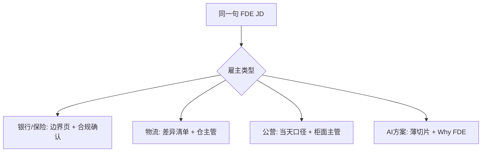

# 同一句 FDE，四类雇主要你证明什么

**FDE-06** · **2026-11-07** · Day 6 · **主题板块** 香港市场 · **难度** 进阶

## 场景

周六早上，你把三份香港岗位说明并排放在一起。标题都写 Forward Deployed Engineer，硬技能都是 Python、SQL、stakeholder。一份挂在虚拟银行，一份挂在第三方物流，一份挂在卖企业 AI 方案的公司。

你按 Day 2 的三列读完了：硬技能、软技能、语言。还是不知道该准备哪一页作品。公开面经里的常见问法是：Why FDE、讲一个你把模糊需求收成交付的例子。香港本地挂着 FDE 的银行和物流几乎没有公开逐字记录；企业 AI / 方案类公司的公开分享会更多提到现场嵌入和 Why FDE。下面的「要你证明什么」是教学对照，不是任何一家机构的招聘原文。

## 概念

岗位名字相同，不代表考官要看的证据相同。进阶读法是在 Day 2 的三列之外，再加一列：**这一版算交了时，谁点头、点头的对象是什么。**

| 雇主类型 | 他真正买的是 | 面试要你交的证明 | 常见误判 |
|----------|--------------|------------------|----------|
| 虚拟银行 / 保险 | 一页可核对的试点边界，合规或业务能回「可以」 | 只读切片 + 边界/不做清单 + 谁确认 | 把作品做成完整产品或算法题单 |
| 物流 | 下一班能执行的差异或例外清单 | 一夜对账差异 + 「夜班不扫这格」写进数据说明 | 只回英文工单，现场例外没落纸 |
| 公营柜面 | 当天同事能执行的同一句口径 | 字段对账 + 当天销号/例外口径 + 主管确认句 | 把「系统以后会改」当成这一版交付 |
| AI 产品 / 解决方案公司 | 现场能用的薄切片，以及 Why FDE | 能跑的薄切片 + Why FDE / Why this work + 下一版才加的约束 | 用会议室演示替代每天用人的确认 |

三句进阶对照：

1. **JD 上的 Python 只说明你要交「一版能指给人看的东西」**，不说明那一版是风险提示、仓差异，还是柜面口径。
2. **软技能那一行要翻译成「谁在哪一天对哪一页点头」**，否则 stakeholder 仍是形容词。
3. **雇主类型决定点头的名词**；面试官换成另一类公司时，换名词，不换「先交可核对的一版」这条骨架。

## 香港落地例子

**主例子：虚拟银行客户经理工作台的三类只读风险提示。** 教学场景。

你要准备的不是「一个 AI 产品」，而是：

| 证明 | 这一版长什么样 | 谁点头 |
|------|----------------|--------|
| 硬技能切片 | 三类字段对得上的只读聚合，不连核心账 | 你自己能当场跑给面试官看 |
| 范围页 | 展示哪三类提示、哪三件明确不做 | 业务或合规用英文回复「这一版可以」 |
| 语言 | 粤语听客户经理旁边的例外；英文写下确认 | 确认落在邮件或方案上，不落在会上的点头 |

同一标题换雇主，只换证明里的名词：

| 雇主类型 | 硬技能切片换成 | 范围页换成 | 点头的人 |
|----------|----------------|------------|----------|
| 物流 | 一夜扫描对上库存后的差异库位表 | 「夜班不扫这格」写进数据说明 | 仓主管：下一班按这张表拣 |
| 公营柜面 | App 预约状态对上早上叫号纸 | 「已取消但纸上还有名 → 主管销号」 | 柜面主管：这句口径今天可以用 |
| AI 产品 / 解决方案公司 | 一个嵌在客户流程里能跑的薄切片 | Why FDE、Why this work；下一版才加的约束 | 每天用这版办事的人，不是只听项目周报的人 |

拓展补充：若 JD 写 Hybrid 或 occasional client site，面试前用三句问清：每周几天在客户场地、验收人是否在场、确认用粤语还是英文落纸。问不清就按「现场有验收人」准备，比按「远程写代码」准备更靠近大多数香港 FDE 说明。

## 面试怎么说

大约一分钟：

> “Same FDE title, four proofs. At a virtual bank I bring a read-only slice and one page of scope a compliance owner can confirm. At a warehouse the proof is a night-shift gap list the supervisor can pick from. At a public counter it is today’s exception script. At an AI solutions company I also answer why FDE: acceptance sits with the person who uses this version, not only with the release train. I change the nouns with the employer. I do not change the habit of shipping one checkable version first.”

现场把例外讲清楚时用对方听得见的话（香港本地团队常用粤语）。边界、不做清单和「谁在哪一天点头」用英文写下来，避免同一句 FDE 在四类雇主那里被你做成同一种作品。

## 小练习

下面三条都来自虚构 JD。各写一行「雇主类型假设 + 你要交的证明（不超过 25 字）」：

1. Comfortable with ambiguity; end-to-end ownership（雇主未写清）
2. On-site with warehouse operations three days a week
3. Partner with customers to land AI workflows in production

## 自测

1. 为什么「我会 Python 和 stakeholder management」还不够回答香港 FDE 的市场题？还缺哪一列？
2. 面试官从虚拟银行换成 AI 产品公司时，你的作品和口头答案各改哪一句？物流仓和公营柜面又改哪个名词？

先写完再打开。

参考答案

### 小练习

一种合格写法：

1. 先假设雇主类型（或缺这列就当场问）；证明是一页边界 + 待确认字段，不补假数。
2. 物流；证明是仓里能执行的差异/例外清单，不是只回工单。
3. AI 方案；证明是客户流程里能跑的薄切片 + Why FDE。

只写「多沟通」「去现场」「做 AI」，没有落到可核对的证明，不算写完。

### 自测 1

Python 和 stakeholder 只说明你会做切片、会跟人对齐。市场题还要你说出：**这一版点头的对象是什么、谁来点头**。缺这一列，你会对着三份 JD 交出同一份算法题单或同一份空泛方案。补上「雇主类型 → 证明 → 点头人」之后，准备作品和面试故事才分得开。

答到「缺点头对象这一列」即算完整。

### 自测 2

骨架不换：先交可核对的一版，再写不做清单和确认人。虚拟银行：只读风险提示 + 合规/业务英文确认。换成 AI 产品公司：薄切片还在，口头多答 Why FDE / Why this work，点头人改成每天用这版的人。物流把名词换成一夜扫描差异和仓主管。公营柜面换成当天销号口径和柜面主管。

答到「换名词、不换先交一版；AI 方案多答 Why FDE」即算完整。

系列：上一篇 · [谁说了算：赞助人、日常对口与真正验收人](FDE-05-2026-11-06-岗位-谁说了算-干系人与验收人.md) · [回到索引](README.md)
