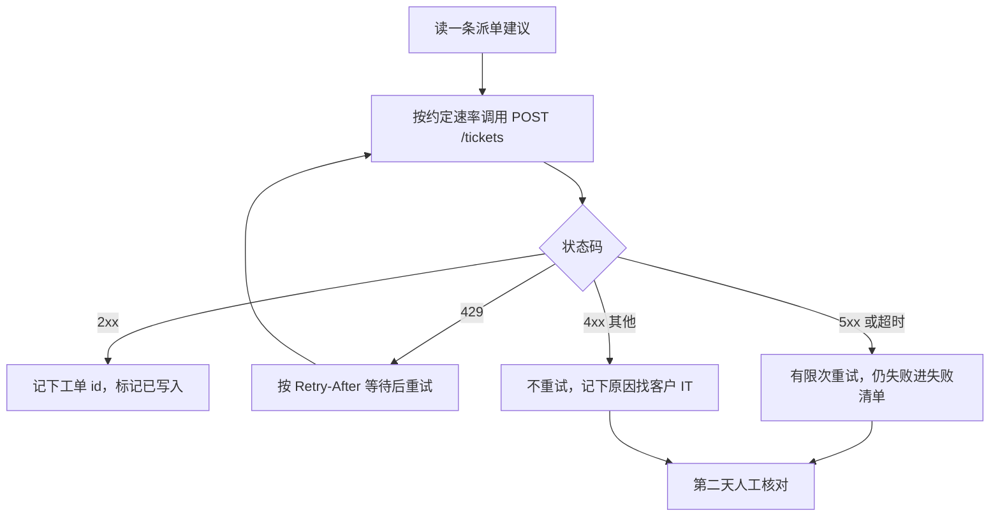

# REST API 设计与调用：状态码、分页、限流

**FDE-09** · **2026-11-10** · Day 9 · **主题板块** 集成 · **难度** 入门

## 场景：派单建议做好了，卡在客户的工单系统
还是物业报修那一单（第 7、8 课）。workshop 上定了：置信度不低于 70% 的报修自动生成派单建议，客服一键确认后，要**写进物业公司现有的工单系统**；另外要把过去一年的历史工单拉下来，给分类模型做评测集。

IT 给了你一份工单系统的 API 文档和一把测试用 API Key。你第一天写的脚本：

- 拉历史工单，只拿到 50 条就停了，以为「一年才 50 单」
- 夜间批量回写派单，跑到一半全是报错，日志里只有一句 `request failed`
- 第二天 IT 找上门：「你昨晚把我哋系统打到 429，师傅 App 都慢咗。」

三件事都不是模型问题，是**不会读、不会用客户的 API**。模块 C 从这里开始：FDE 的日常硬功夫，是把你的东西安全地接进客户已有的系统。

## 类比：你在微博接过的内部服务
微博里你调用别组的用户服务、关系服务，一定会问三件事：

- 返回码怎么约定？哪些错可以重试，哪些重试了也没用？
- 列表接口一次给多少？翻页用 offset 还是游标（cursor）？
- 调用方配额多少？高峰时被限流，降级策略是什么？

客户的 API 就是一个「你不能改、也不能催上线修」的外部依赖。区别只是：内部服务挂了你可以找同事，客户系统被你打挂，丢的是信任。

## 概念

### 它解决什么问题
REST API 是客户系统对外开放的「门」：用 HTTP 方法（GET 读、POST 新建、PUT/PATCH 改、DELETE 删）加资源路径（如 `/tickets`、`/tickets/{id}`）操作数据。FDE 很少从零设计一个大 API，更常见的是**调用客户的 API**，再给自己的服务**开几个小接口**。两边都要懂同一套约定：状态码、分页、限流。

### 状态码：先分清「谁的错、能不能重试」
| 类别 | 常见码 | 意思 | 你该怎么做 |
|------|--------|------|------------|
| 2xx 成功 | 200、201、204 | 成功；201 表示新建了资源 | 记下返回的 id，别再建一次 |
| 4xx 调用方的错 | 400、401、403、404、409、422 | 参数错、没认证、没权限、找不到、冲突、校验不过 | **不要盲目重试**，修请求或找人 |
| 429 | Too Many Requests | 你太快了 | 等一下再试，看 `Retry-After` |
| 5xx 服务端的错 | 500、502、503、504 | 对方出问题或超时 | 可以有限次重试，并加退避 |

两个容易错的点：
- **401 和 403 不一样**：401 是「你是谁我不认识」（Key 错或过期），403 是「我认识你，但你没权限」（找 IT 开权限，重试没用）。
- **有的系统出错也返回 200**，把错误写在 body 的 `success: false` 里。别只看状态码，要读文档、看 body。

### 分页：为什么你只拿到 50 条
列表接口不会一次吐出全部数据。两种常见做法：

- **页码 / offset**：`GET /tickets?page=2&page_size=50`。简单，但拉取期间有新单插入，可能漏条或重复。
- **游标（cursor）**：返回里带 `next_cursor`，下一次带上它。数据在变时更稳，大系统多用这种。

拉全量的正确姿势：一直请求，直到返回说「没有下一页」（没有 `next_cursor`，或返回条数少于 page_size），而不是第一页就收工。最后**核对总数**：如果接口给 `total`，就对一下；不给，就请 IT 用后台导出一个数字对账。

### 限流：429 是客户在保护自己
客户系统通常会限制每个 Key 的调用频率（例如每分钟多少次）。超了就回 429，响应头里常带 `Retry-After`（几秒后再来）或剩余额度。

调用方的基本礼貌：
1. **先问额度**：「这把 Key 每分钟可以调几次？夜间有没有批处理窗口？」
2. **主动控速**：批量任务自己限速，不要等对方 429 才慢下来。
3. **收到 429 就等**：按 `Retry-After` 等；没有就等一会儿再试，每次等更久（退避，第 12 课细讲）。
4. **避开高峰**：物业师傅 App 白天也在用同一套系统，批量回写放在约定的夜间窗口。

### 一次批量回写的流程

### 会在哪里坏
- **只看第一页**：评测集少了九成数据，结论全错。
- **日志只写「失败」**：不记状态码和响应 body，排查时没人知道是 401、422 还是 503。
- **5xx 后盲目重试 POST**：对方其实已经建好工单，只是响应超时，你再发一次就有两张重复工单。先记住这个坑，第 12 课讲幂等。
- **拿测试 Key 跑生产量**：测试环境额度小，或者根本连的是另一套数据。

## 香港落地例子
物业报修项目里，你要和客户 IT 在开工前对齐一张「接口约定表」，写进 one-pager 的附录：

| 项目 | 问 IT 的问题 | 本案约定（虚构示例） |
|------|---------------|----------------------|
| 读历史 | 分页方式？有没有 total？ | 游标分页，每页 50，无 total，由 IT 后台导出总数对账 |
| 写工单 | 成功返回什么？重复提交怎么办？ | 201 返回工单号；同一建议只写一次，失败单进清单 |
| 限流 | 每分钟几次？批量窗口？ | 白天低速，夜间约定时段批量 |
| 出错 | 业务错误返回 4xx 还是 200 带错误字段？ | 按文档两种都处理 |
| 环境 | 测试和生产 Key 是否分开？ | 分开，生产 Key 由 IT 交付当天发 |

四类雇主的差异（对照即可）：

| 雇主类型 | 这件事上的侧重点 |
|----------|------------------|
| AI 原生 / 产品公司 | 常有自家标准连接器，FDE 要判断客户 API 哪些坑该回流成产品能力 |
| 大厂云与平台 | 多半用 API 网关做限流和监控，要讲清配额在哪一层设 |
| 咨询与系统集成 | 接口约定表本身就是交付物，要签字、进变更管理 |
| 甲方企业内部（如银行、保险） | 内部系统常走统一网关，申请调用权限要排期，限额更保守 |

## 面试怎么说
**题目**（公开面经里的常见问法类型）：「客户给你一个 REST API，你要把一年历史数据同步过来，并每天增量回写。你会注意什么？」

**答题思路**：先澄清（数据量、分页方式、限额、测试和生产环境），再讲三件事：按状态码分类处理（4xx 不重试、429 等待、5xx 有限重试）、分页拉到底并对账、主动控速并避开业务高峰。最后补一句风险：POST 重试可能重复写入，需要幂等设计。能类比微博调用内部服务的配额和降级更好。

## 小练习
打开任意一个公开 API 的文档（例如 GitHub REST API 的「列出仓库 issue」接口），用 10 分钟找出三样东西，写在一张便条上：

1. 它用页码还是游标分页？怎么知道还有下一页？
2. 它的限流额度是多少？超了返回什么状态码、哪个响应头告诉你还剩多少？
3. 挑两个错误码，写一句「我收到它时该怎么做」。

写完对照本课的状态码表，看你的处理方式是否分清了「能重试」和「不能重试」。

## 一句话带走
**调用客户 API，先分清错误是谁的、能不能重试，再把分页拉到底并对账，最后主动控速，别让客户的系统为你的脚本买单。**

## 自测

1. 夜间批量回写时，你收到一批 403 和一批 503。两者分别说明什么？你会分别怎么处理？
2. 如果你在甲方企业内部（例如一家香港银行）做 FDE，要从核心系统的 API 拉客户投诉记录，和在物业公司拉工单相比，开工前你多问哪两件事？

先用自己的话写两三句，再打开答案。

参考答案

**第 1 题**：403 表示对方认得你的 Key，但这把 Key 没有写工单的权限，属于调用方问题，重试一百次也一样，应停下这一类请求，记下请求和响应，找客户 IT 开权限。503 表示对方服务暂时不可用（维护或过载），可以有限次重试并逐次拉长等待；仍失败就进失败清单，第二天人工核对。要特别确认 503 的单是否其实已写入，避免重复工单。

**第 2 题**：一是权限与审批：银行内部系统通常要经统一 API 网关，调用权限、数据范围（能否拿到客户个人资料）要走申请和合规审批，排期要算进计划。二是限额与时段：核心系统更保守，常只允许在指定时段、低频率调用，或要求改用批量导出文件。另可补充：日志里不能落敏感字段，要脱敏。

## 延伸观看
- [Rate Limiter System Design: Token Bucket, Leaky Bucket, Scaling](https://www.youtube.com/watch?v=YXkOdWBwqaA)（ByteByteGo）：从服务端角度讲限流怎么做、为什么返回 429 和剩余额度头，看完更懂客户为什么限你。

系列：上一篇 · [Demo 与 workshop：怎么给非技术人讲技术取舍](FDE-08-2026-11-09-需求发现-Demo与workshop.md) · 下一篇 · [Webhook：推 vs 拉、签名校验、重放](FDE-10-2026-11-11-集成-Webhook推拉签名重放.md) · [回到索引](README.md)
