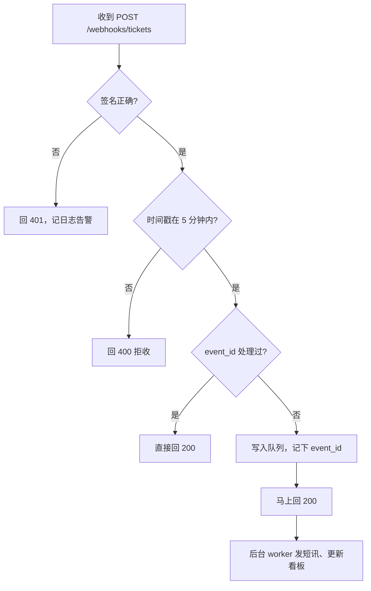

# Webhook：推 vs 拉、签名校验、重放

**FDE-10** · **2026-11-11** · Day 10 · **主题板块** 集成 · **难度** 入门到进阶

## 场景：师傅完工了，你的系统第二天才知道
还是物业报修那一单（第 7 到 9 课）。上一课你已经能把派单建议写进客户的工单系统。现在客服主管提了新要求：**师傅在 App 上点「完工」后，5 分钟内要自动给住户发确认短讯，并把这单从「待跟进」看板上撤掉**。

你第一版的做法是每 10 分钟拉一次 `GET /tickets?status=done`。结果：

- 平均要等 5 分钟，最坏 10 分钟，主管说「唔够快」
- 每天几千次请求里九成九是空手而回，IT 又来提限流（第 9 课的 429）
- 拉的时间窗口没对齐，偶尔漏掉一单，住户没收到短讯

IT 说：「我哋系统支持 webhook，你畀条 URL 我，有单完工我主动通知你。」这一课就讲：怎么安全地**接住**别人推过来的事件。

## 概念

### 推和拉
| 方式 | 谁主动 | 优点 | 缺点 | 适合 |
|------|--------|------|------|------|
| 拉（轮询 polling） | 你定时去问 | 简单，你控制节奏，对方挂了你也知道 | 延迟高、浪费请求、容易撞限流 | 变化少、对方不支持推、做兜底对账 |
| 推（webhook） | 对方有事件就调你的 URL | 近实时、省请求 | 你要开一个公网可达的接口，要防伪造、防重复、防丢 | 状态变化通知：完工、付款成功、审批通过 |

Webhook 本质上就是**对方调用你的 REST API**。第 9 课你是调用方，这一课你是被调用方，要反过来替对方着想：回得快、回得准、能承受重复。

实战里很少二选一：**webhook 负责快，定时拉取负责兜底**。每晚拉一次当天完工单，和收到的事件对账，补上漏掉的。

### 签名校验：确认真的是客户系统发来的
你的 webhook URL 暴露在公网，谁都能 POST 一个 `{"status": "done"}` 进来。如果不校验，任何人都能让系统给住户乱发短讯。

最常见的做法是 **HMAC 签名**：

1. 开通时，客户系统和你约定一个**共享密钥**（secret），只放在双方的密钥管理里，不进代码库、不发聊天群
2. 每次推送，对方用这个 secret 对「时间戳 + 请求体原文」算一个 HMAC-SHA256，放在请求头里，例如 `X-Signature` 和 `X-Timestamp`
3. 你收到后用同一个 secret、同样的拼法再算一遍，**两者一致才处理**

三个常见坑：
- **要用请求体原文算**。框架先把 JSON 解析再序列化，空格或字段顺序一变，签名就对不上
- **比较用常量时间函数**（Python 的 `hmac.compare_digest`），不要用 `==`
- **密钥要能轮换**：换密钥那几天，两把都认

### 重放：签名对了，也可能是旧请求
攻击者截到一条合法请求，原样再发一次，签名照样是对的。这叫**重放攻击**。另外，正常情况下对方也会**重复投递**：你回得慢、超时了，对方就当失败重发。所以要两道防线：

- **时间窗口**：时间戳和现在相差超过约 5 分钟就拒收。时间戳在签名范围内，改不了
- **事件 ID 去重**：每个事件带唯一 `event_id`，处理前查一下处理过没有，处理过就直接回 200、不再发短讯。这就是幂等，第 12 课细讲

### 接收端的标准流程

关键一句：**先验证、先入队、马上回 2xx，重活放后台做**。对方通常只等几秒，你在请求里同步发短讯，一慢就超时，对方重发，住户就收到两条。

### 会在哪里坏
- **处理完才回 200**：下游一慢就超时，引发重复投递
- **不做兜底对账**：你的服务重启那几分钟，事件就丢了，没人知道
- **事件乱序**：「已完工」比「已派单」先到。要按事件里的时间或版本号判断，不能按到达顺序直接覆盖状态
- **测试环境用公网随便开端口**：开发时用隧道工具临时暴露，交付时要走客户批准的入口

## 香港落地例子
物业报修项目里，开通 webhook 前要和客户 IT 对一张「事件约定表」，放进 one-pager 附录：

| 项目 | 问 IT 的问题 | 本案约定（虚构示例） |
|------|---------------|----------------------|
| 事件类型 | 推哪些事件？ | 只订阅「完工」「取消」两种 |
| 签名 | 算法？签哪些内容？头叫什么？ | HMAC-SHA256，签「时间戳.请求体」 |
| 重试 | 失败重试几次、间隔多久？ | 最多 5 次，间隔逐次拉长，约 1 小时内放弃 |
| 去重 | 有没有唯一事件 ID？ | 有 `event_id`，我方保存 7 天 |
| 网络 | 客户能不能调到我们的公网地址？ | 走客户防火墙白名单，固定出口 IP |
| 兜底 | 有没有「按时间查事件」的接口？ | 每晚 2 点拉当天完工单对账 |

四类雇主的差异（对照即可）：

| 雇主类型 | 这件事上的侧重点 |
|----------|------------------|
| AI 原生 / 产品公司 | 产品自己也要对外发 webhook，FDE 常要把客户踩到的坑（重复、乱序）反馈成产品的重试和签名设计 |
| 大厂云与平台 | 多用平台自带的事件总线和网关做签名、重试、死信队列，要讲清哪一层负责什么 |
| 咨询与系统集成 | 事件约定表和对账报告本身是交付物，要客户签字 |
| 甲方企业内部（如银行、保险） | 内网系统往往不允许外部回调进来，常改成内部消息队列或文件交换，安全团队要审每个入口 |

## 面试怎么说
**题目**（公开面经里的常见问法类型）：「客户系统支持 webhook，你要在订单状态变化时触发后续流程。你会怎么设计接收端？」

**答题思路**：先澄清（事件类型、量级、对方的重试策略、有没有签名和事件 ID），再讲四件事：HMAC 签名校验加时间窗口防重放；按事件 ID 去重保证幂等；先入队马上回 2xx，后台处理；定时拉取对账兜底，并处理乱序。最后补一句取舍：如果客户在内网、回调进不来，就退回定时拉取或消息队列。能联系到你在微博做过的消息队列和消费幂等，会很加分。

## 小练习
用 15 分钟，在本地写一个不到 20 行的 Python 函数 `verify(secret, timestamp, raw_body, signature) -> bool`：

1. 用 `hmac.new(secret, f"{timestamp}.".encode() + raw_body, hashlib.sha256).hexdigest()` 算出期望签名
2. 用 `hmac.compare_digest` 比较
3. 时间戳和当前时间相差超过 300 秒就返回 False

然后自己造三条测试：正确请求、改了一个字的请求体、10 分钟前的时间戳。三条结果分别应该是 True、False、False。

## 一句话带走
**Webhook 负责快，定时拉取负责兜底；接收端先验签、防重放、按事件 ID 去重，入队后马上回 2xx。**

## 自测

1. 你的 webhook 接收端在请求里同步发短讯，某天短讯服务变慢，住户开始投诉「收到两三条完工短讯」。为什么会这样？你会怎么改？
2. 如果是一家香港银行，想在客户投诉工单状态变化时通知你的 AI 分类服务，但安全团队说「外部系统不准回调进内网」。你会提出什么替代方案？各有什么代价？

先用自己的话写两三句，再打开答案。

参考答案

**第 1 题**：发短讯慢导致响应超过对方的超时时间，对方当作投递失败并重发同一事件；接收端没有按事件 ID 去重，每次重发都再发一条短讯。改法：收到后先验签、按 `event_id` 去重，写入队列后马上回 200；由后台 worker 发短讯，发之前再查一次该事件是否已处理；短讯服务慢只会让队列积压，不会触发重发。

**第 2 题**：一是改为定时拉取：AI 服务按约定频率从内部 API 拉状态变化，代价是延迟和额外请求，要和 IT 约好限额与时段。二是走银行已有的内部消息队列或事件平台：工单系统发事件到队列，AI 服务在内网订阅，代价是要申请接入、排期，并通过安全审查。三是批量文件交换（例如每小时导出一次），最简单也最慢，只适合不急的场景。选哪种取决于业务对延迟的要求，可以先用定时拉取上线，再推动接入消息队列。

## 延伸观看
- [Top 3 Things You Should Know About Webhooks!](https://www.youtube.com/watch?v=x_jjhcDrISk)（ByteByteGo，约 4 分钟）：用支付回调讲轮询和 webhook 的取舍，以及兜底拉取、签名校验、幂等、队列四条实践，和本课一一对应。

系列：上一篇 · [REST API 设计与调用：状态码、分页、限流](FDE-09-2026-11-10-集成-REST-API状态码分页限流.md) · 下一篇 · [认证授权：API Key、OAuth 2.0、JWT、SSO/SAML](FDE-11-2026-11-12-集成-认证授权APIKey-OAuth-JWT-SSO.md) · [回到索引](README.md)
