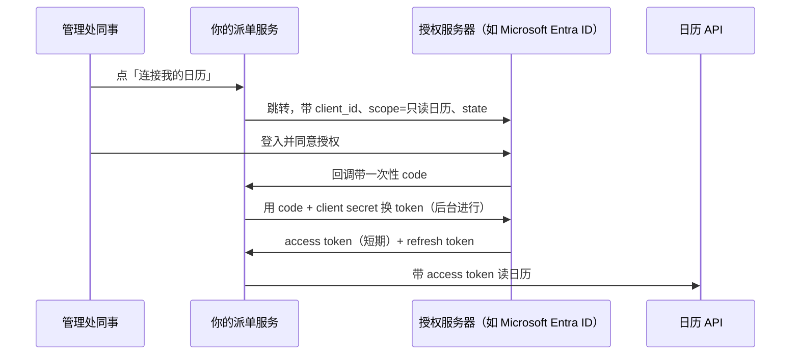

# 认证授权：API Key、OAuth 2.0、JWT、SSO/SAML

**FDE-11** · **2026-11-12** · Day 11 · **主题板块** 集成 · **难度** 入门到进阶

## 场景：同一个项目，四道门要四把钥匙
物业报修项目继续往前走（第 7 到 10 课）。到了接正式环境这一周，你发现要过的「门」一下子变成四道：

- 调客户**工单系统**的 REST API，IT 发来一条 API Key，说「放 header 就得」
- 要读管理处同事的 **Microsoft 365 日历**，看师傅几点有空，IT 说「要走 OAuth，唔可以畀你账号密码」
- 你自己做的**派单看板**要给管理处主管登入，IT 说「唔好另外开账号，用公司 SSO」
- 上一课收 webhook 的接口，对方签名你验了；但你的看板 API 被前端调用时，要验一个 **JWT**

四样东西名字都像「登入」，其实回答的是不同问题。这一课把它们分开讲清楚。

## 概念

### 先分清两个词
- **认证（Authentication，AuthN）**：你是谁？证明身份
- **授权（Authorization，AuthZ）**：你能做什么？在身份之上判断权限

很多事故不是「没认证」，而是「认证了，但授权太宽」：一个只该读工单的 Key，实际可以改、可以删。

### 四样东西各管什么
| 方式 | 回答什么问题 | 谁对谁 | 典型用法 | 常见坑 |
|------|--------------|--------|----------|--------|
| API Key | 这个调用来自哪个系统 | 系统对系统 | 你的服务调客户工单 API | 写进代码库、发进聊天群；权限太大；没有轮换和过期 |
| OAuth 2.0 | 用户允许这个应用代他做哪些事 | 应用代用户（或代自己）访问资源 | 读同事日历、读邮箱 | 把它当成「登入协议」；scope 要太多；token 存在前端 |
| JWT | 这张票据是谁发的、内容有没有被改过 | 一种令牌**格式** | OAuth 的 access token、你自己 API 的会话令牌 | 不验签名或接受 `alg: none`；不看过期；把敏感资料放进去（只是编码，不是加密） |
| SSO（SAML / OIDC） | 用公司已有的身份系统登入你的应用 | 员工对你的应用 | 主管用公司账号登入看板 | 只做了登入，没映射角色；离职员工停用后会话还活着 |

一句话串起来：**API Key 管系统身份，OAuth 管代授权，JWT 是装身份信息的信封，SSO 是让员工用公司身份登入你的应用**。OIDC 是在 OAuth 2.0 之上加了「登入」这一层，所以现在新项目的 SSO 多用 OIDC，老企业系统常见 SAML（XML 断言，由身份提供方签名）。

### OAuth 2.0 的骨架（授权码流程）

要记住三个点：
- **用户密码从头到尾不经过你**，这正是 IT 不肯给你账号密码的原因
- **scope 决定能做什么**：只要「读日历」，就不要申请「读写邮件」
- **没有用户参与的系统对系统**，用 client credentials 流程：服务用自己的 client id 和 secret 换 token，常用来替代长期不过期的 API Key

### JWT 验什么
收到一个 JWT，至少检查：签名（用发行方公开的公钥，按约定算法）、`iss` 是不是你信任的发行方、`aud` 是不是发给你这个服务的、`exp` 有没有过期。全部通过之后，再按里面的角色或 scope 做授权判断。

### 会在哪里坏
- **密钥散落**：API Key、client secret 出现在 Git、Postman 导出、聊天记录里。要放密钥管理，按环境分开（第 36 课细讲）
- **token 过期就全挂**：没写 refresh 逻辑，第一个钟头一切正常，之后全部 401
- **权限只在前端隐藏按钮**：后端 API 没检查角色，懂行的人直接调接口
- **离职与停用**：SSO 停了账号，但你的应用自己发的长期会话还有效。会话要短，或定期回查

## 香港落地例子
物业报修项目上线前，和客户 IT 对一张「接入方式表」，放进 one-pager 附录：

| 接入对象 | 方式 | 本案约定（虚构示例） | 负责人 |
|----------|------|----------------------|--------|
| 工单系统 API | API Key | 只读工单、可写「派单建议」字段；测试和正式各一条；90 天轮换 | 客户 IT 发放，我方保管 |
| 同事日历 | OAuth 2.0 授权码 | scope 只要只读日历；token 存后台，不进浏览器 | 客户 IT 在身份平台登记应用 |
| 派单看板登入 | SSO（OIDC） | 用公司身份平台；「主管」「客服」两个群组对应两种角色 | 客户 IT 建群组，我方做角色映射 |
| 看板前后端 | JWT | 由身份平台签发；后端验签名、iss、aud、exp | 我方 |

四类雇主的差异（对照即可）：

| 雇主类型 | 这件事上的侧重点 |
|----------|------------------|
| AI 原生 / 产品公司 | 产品要支持企业 SSO 和多租户权限，FDE 常帮客户配 SSO、对角色，并把卡住的地方反馈给产品 |
| 大厂云与平台 | 多用平台自带的身份与访问管理（IAM）、服务账号和托管密钥，要讲清哪个角色有哪些权限 |
| 咨询与系统集成 | 接入方式表和权限矩阵本身是交付物，要客户安全团队签字 |
| 甲方企业内部（如银行、保险） | 身份平台是现成的，审批流程长；最小权限、审计日志、定期复核权限都是硬要求 |

## 面试怎么说
**题目**（公开面经里的常见问法类型）：「你的 AI 应用要读客户员工的邮件或日历，并给内部主管一个管理界面。认证授权你会怎么设计？」

**答题思路**：先分清认证和授权，再按对象拆：读员工数据用 OAuth 2.0 授权码流程，scope 只要最小权限，token 放后台并处理刷新；系统对系统用 client credentials 或 API Key，放密钥管理、定期轮换；管理界面接客户的 SSO（OIDC 或 SAML），把客户群组映射成应用角色；后端每个接口都验 JWT 并检查角色，不靠前端隐藏按钮。最后补一句上线前要和客户安全团队对齐的事：审计日志、离职停用多久生效、密钥谁保管。

## 小练习
用 15 分钟，用 Python 的 PyJWT 写两个函数：

1. `issue(secret, user, role)`：签发一个 HS256 的 JWT，带 `sub`、`role`、`aud="dispatch-board"`，`exp` 设为 5 分钟后
2. `check(token, secret, need_role)`：用 `jwt.decode(token, secret, algorithms=["HS256"], audience="dispatch-board")` 验证，再检查 `role` 是否等于 `need_role`

自己造三条测试：正常的主管 token 访问主管接口（通过）、客服 token 访问主管接口（拒绝，这是授权失败）、过期 token（拒绝，这是认证失败）。想一想：这两种失败，接口应该分别回 403 还是 401？

## 一句话带走
**API Key 管系统身份，OAuth 管代授权，JWT 是带签名的票据格式，SSO 让员工用公司身份登入；认证通过之后，每个接口还要在后端做授权判断。**

## 自测

1. 客户 IT 说：「OAuth 太麻烦，我直接畀个管理员账号密码你，你用嚟读全部同事日历啦。」你会怎么回应？有什么替代做法？
2. 你在一家大厂云平台做 FDE，客户要让他们的 AI 客服服务调用平台上的模型和存储。安全团队要求「不准用长期不过期的密钥」。你会怎么设计这条调用的身份和权限？

先用自己的话写两三句，再打开答案。

参考答案

**第 1 题**：礼貌拒绝，并说明风险：共享管理员密码等于这个应用拥有管理员的所有权限，出事无法追查是谁做的，改密码时系统还会中断，审计也过不了。替代做法：在客户的身份平台登记一个应用，按需要选 OAuth 授权码（每位同事自己同意）或由管理员一次性批准的应用权限，scope 只给「只读日历」，必要时再限定只能读特定群组的日历。凭证放密钥管理，并把这个安排写进接入方式表，让客户安全团队签字。

**第 2 题**：给 AI 客服服务一个专用的服务身份（服务账号或角色），按最小权限只授予「调用指定模型」和「读写指定存储位置」。运行时由平台签发短期临时凭证，自动轮换，不在代码或配置里放长期密钥；跨账号或跨环境访问用「承担角色」换临时凭证。再加上审计日志记录每次调用，并定期复核权限。代价是初次配置和排错更复杂，要和客户把角色与权限范围写清楚。

## 延伸观看
- [OAuth 2 Explained In Simple Terms](https://www.youtube.com/watch?v=ZV5yTm4pT8g)（ByteByteGo）：用短动画讲清 OAuth 2.0 里几个角色和授权码流程，对应本课的时序图。
- [Session vs Token Authentication in 100 Seconds](https://www.youtube.com/watch?v=UBUNrFtufWo)（Fireship）：约 100 秒讲会话和令牌（含 JWT）两种登入状态的差别，适合配合小练习看。

系列：上一篇 · [Webhook：推 vs 拉、签名校验、重放](FDE-10-2026-11-11-集成-Webhook推拉签名重放.md) · 下一篇 · [幂等、重试、退避：为什么集成一定会失败](FDE-12-2026-11-13-集成-幂等重试退避.md) · [回到索引](README.md)
