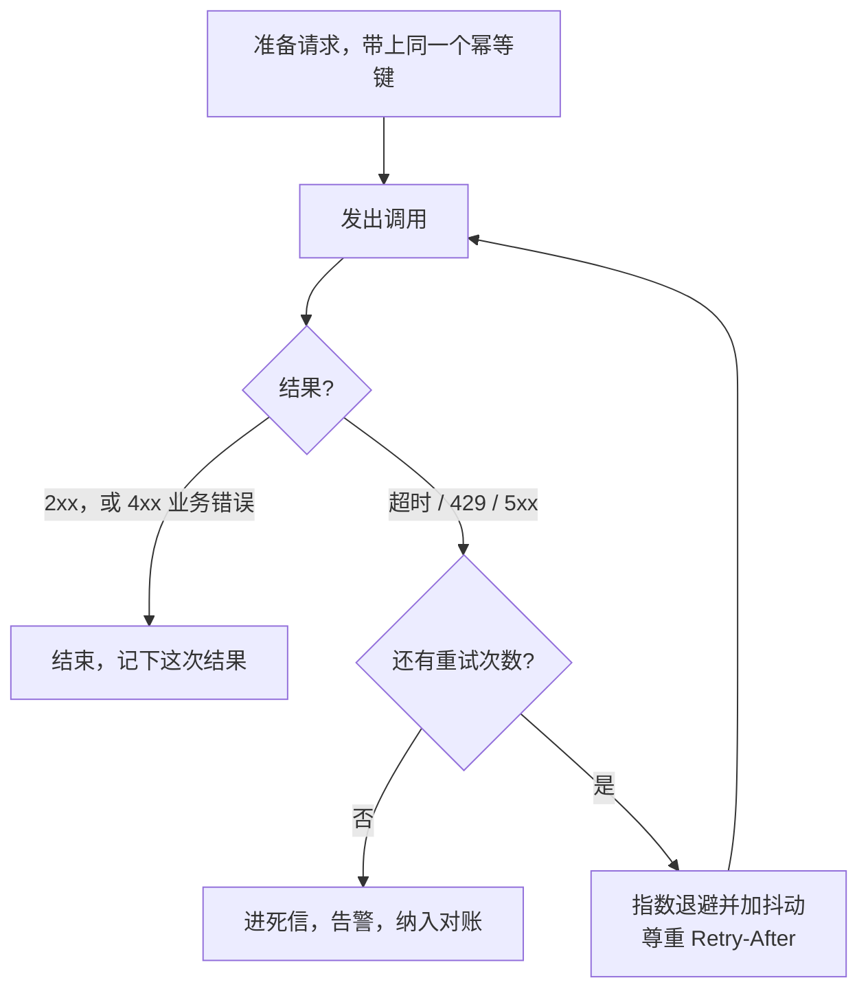

# 幂等、重试、退避：为什么集成一定会失败

**FDE-12** · **2026-11-13** · Day 12 · **主题板块** 集成 · **难度** 入门到进阶

## 场景：超时了，工单里却出现两条建议
物业报修项目继续往前走（第 7 到 11 课）。工单 API、完工 webhook、四道门都接上了。上线第一周，客服主管打电话来：「同一单出现了两条派单建议，有住户还收到两条完工短讯。」

你翻日志，看到三种都像「偶发」的失败：

- 写派单建议的 `POST` 等了 30 秒超时，你按失败又发了一次；工单系统其实第一次已经写进去了，只是响应在回来的路上丢了
- 下游变慢，开始回第 9 课讲过的 429；你马上重试，对方限流更狠
- 第 10 课已经用 `event_id` 给 webhook 去过重，但有一条发短讯的路径绕开了去重，对方一重投，短讯就发了两次

这一课要讲清楚一件事：**集成一定会失败**。失败之后怎么重试，才不会把同一件事做两遍。

## 概念

### 超时不等于失败
网络会丢包，网关会排队，对方也会重启。你在客户端看到「超时」时，其实分不清是哪一种：

1. 请求还没到对方
2. 对方做了一半
3. 对方做完了，响应在回来的路上丢了

对只读查询，再问一次通常没问题。对有副作用的操作（新建一条建议、发短讯、扣款），把超时当成失败再做一遍，就会出现主管看到的那种重复。

### 幂等：同一意图做一次和做多次，结果一样
- `GET` 查工单：天然幂等
- `PUT` 把「派单建议」字段写成同一段文字：通常幂等
- `POST` 每来一次就新建一条建议：通常不幂等

让 `POST` 也可以安全重试，靠的是**幂等键**（常见请求头是 `Idempotency-Key`）：

- 为「这一次意图」准备一个键，第一次请求和以后每一次重试都带**同一个**键
- 服务端按这个键记住第一次的处理结果；再见到就直接返回第一次的响应，不再新建

第 10 课 webhook 按 `event_id` 去重，是你作为**接收方**的幂等。这一课补上：你作为**调用方**，写出去的请求也要带键。

键从哪来？有自然唯一的业务含义时，用业务键更稳，例如 `ticket-8831:dispatch-suggestion`（同一张工单的「写派单建议」本来就只该发生一次）。没有自然键时，再用一次性的 UUID，并且重试时绝不能换新的。

### 哪些错可以重试
| 情况 | 能否重试 | 原因 |
|------|----------|------|
| 超时、连接失败 | 有幂等才能重试 | 不知道对方做没做完 |
| 429、503，或带了 `Retry-After` | 可以，必须先等 | 对方暂时过载 |
| 502、504 | 通常可以 | 网关或下游瞬时故障 |
| 400、401、403、404、422 | 不要重试同一份请求 | 改请求或改凭证再试，原样重发没有用 |
| 409 冲突 | 先看约定 | 可能是同一个键配了不同的请求体，要排查，不是盲目再发 |

一句话：**重试解决「至少做一次」，幂等解决「最多做一次」；两样加在一起，才接近「恰好一次」。** 只重试、没有幂等，重复就会来。

### 退避：不要马上再打
间隔按指数拉长，比如 1 秒、2 秒、4 秒，并设一个上限。再加一点**抖动（jitter）**：在间隔上加随机数，避免所有调用方在同一秒一起回来，把刚缓过来的系统再打垮。对方回了 `Retry-After`，以它为准。

还要有停手的条件：次数或总时长用完，就进入死信并告警，不要无限重试。如果调用链上每一层都自己重试，一次失败会被放大成很多请求，约定好**只在最外层重试**。

服务端再见到同一个键，直接返回第一次的结果，不会再走一遍「新建」。

### 会在哪里坏
- **无脑重试所有错误**：401、400 再发一百次也不会好
- **没有抖动**：下游一恢复，所有人同一秒打回来
- **只在自己这边少发一次**：超时常常发生在「对方已写入、响应丢失」，你必须再发；所以保护要落在服务端，或对方 API 真正支持幂等键
- **每次重试都换新键**：等于没有幂等
- **键过期太短**：当晚对账再跑一遍，又新建一条
- **超时后立刻去做「补偿删除」**：补偿再超时，状态更乱。先查询现状，或放到对账里处理

## 香港落地例子
物业报修上线前，和客户 IT 对一张「失败与重试约定表」，放进 one-pager 附录：

| 操作 | 幂等怎么做 | 重试策略 | 用完次数之后 |
|------|------------|----------|--------------|
| 写派单建议到工单 | 对方支持 `Idempotency-Key` 就用；不支持就改成按 `ticket_id` 更新同一字段（`PUT`），或先查询再决定写不写 | 超时 / 429 / 5xx，最多 5 次，指数退避加抖动，尊重 `Retry-After` | 入死信，告警，纳入每晚对账 |
| 发完工短讯 | 继续用第 10 课的 `event_id`，处理过就不再发 | 接收端马上回 2xx，后台发短讯；短讯网关失败仍带同一 `event_id` 再试 | 对账补发前先查是否已发送 |
| 写入日历忙时 | 用 `ticket_id + 日期` 作业务键，已有事件就返回已有的 | 同上 | 人工或对账处理 |

若对方 API 不支持幂等键，不要假装 `POST` 可以安全重试。改成可幂等的更新、先查再写（注意查询和写入之间仍有空隙），或把「请对方加幂等键」写成范围变更，让客户签字。

四类雇主的差异（对照即可）：

| 雇主类型 | 这件事上的侧重点 |
|----------|------------------|
| AI 原生 / 产品公司 | 对外 API 要支持幂等键；FDE 常把客户遇到的重复调用和重复计费反馈给产品。调用模型时，超时重试也可能被记成两次 |
| 大厂云与平台 | 多用平台 SDK 和队列的重试、可见性超时，要先问清哪一层已经在重试，避免层层叠加 |
| 咨询与系统集成 | 失败与重试约定表本身是交付物，要客户签字 |
| 甲方企业内部（如银行、保险） | 涉及账务、保单的接口往往禁止盲目自动重试，超时后要先查状态；审计日志要能看清是第几次尝试 |

## 面试怎么说
**题目**（公开面经里的常见问法类型）：「调用客户 API 写入数据时经常超时，你会怎么保证既不会丢、也不会写两遍？」

**答题思路**：先承认超时不等于失败，客户端分不清请求有没有落下去。做法是「至少一次的重试」加上「至多一次的幂等」：只对瞬时错误重试（超时、429、5xx），用指数退避加抖动，尊重 `Retry-After`，并设次数上限；每一次重试都带同一个幂等键或业务键，让服务端返回第一次的结果。对方不支持键，就改成幂等更新或先查再写，并加对账兜底。最后补一句：不要在调用链的每一层都重试。

## 小练习
用 15 分钟，用 Python 写两个小函数：

1. `backoff(attempt)`：返回 `min(2 ** attempt, 32) + random.uniform(0, 1)` 秒（`attempt` 从 0 起）
2. `call(store, key, fn)`：若 `key` 已在字典 `store` 里，直接返回存着的结果；否则调用 `fn()`，把结果存进去再返回

自己造三次调用：同一个 `key` 调两次（`fn` 只应执行一次），换一个 `key` 再调一次（`fn` 再执行一次）。想一想：如果第一次 `fn()` 已经成功，但在「把结果写入 `store`」之前进程挂了，下一次会怎样？要把「执行」和「记下这个键」放在怎样的边界上，才比较稳？

## 一句话带走
**超时不等于失败；用幂等保证至多一次，用带抖动的指数退避做有限次重试，两者加在一起才接近「恰好一次」。**

## 自测

1. 你向工单系统 `POST` 一条派单建议，30 秒后客户端超时。对方说他们的 API 不支持幂等键，而且每次 `POST` 都会新建一条建议。你下一步怎么做？能不能马上再 `POST` 一次？
2. 你在一家 AI 产品公司做 FDE，客户的系统调用你们的「生成摘要」接口。他们投诉：一次超时后重试，被记了两次调用、收了两份费用，摘要还生成了两份。你会怎么改产品侧和客户侧？

先用自己的话写两三句，再打开答案。

参考答案

**第 1 题**：不能马上再 `POST`。超时可能是对方已经写成功、只是响应丢了，再 `POST` 就会变成两条建议。下一步先按 `ticket_id`（或请求里带过的业务流水号）用 `GET` 查有没有刚写进去的建议。已经有了，就当作成功，不要再写。没有，再写一次，同时推动改成 `PUT` 更新同一字段，或请对方加上幂等键。把这条路径写进失败约定表，并纳入每晚对账。

**第 2 题**：产品侧为「生成摘要」提供幂等键：同一键在约定有效期内返回第一次的结果和计费记录，不重新生成，也不再记一次费用。客户侧要在第一次请求就生成键，重试带同一个键，不要每次换新键；只对超时和 5xx 重试，并加退避。再和客户核对计费是按「成功生成次数」还是「HTTP 请求次数」。必要时提供「按业务 ID 查询上次结果」的接口，方便对方超时后先查再决定。

系列：上一篇 · [认证授权：API Key、OAuth 2.0、JWT、SSO/SAML](FDE-11-2026-11-12-集成-认证授权APIKey-OAuth-JWT-SSO.md) · [回到索引](README.md)
