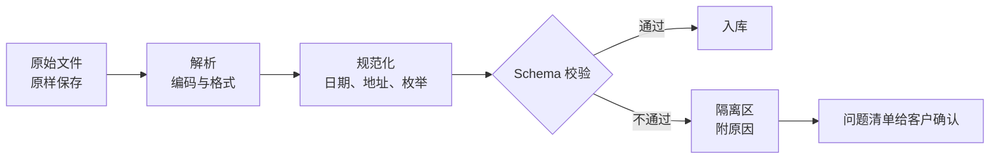

# 数据格式与转换：JSON/CSV/XML、schema 校验、脏数据处理

**FDE-13** · **2026-11-14** · Day 13 · **主题板块** 集成 · **难度** 入门到进阶

## 场景：一份 CSV，三种乱码
物业报修项目继续（第 7 到 12 课）。接口、webhook、认证、重试都接好了。周五下午，客户把三家外判维修承办商的「历史工单」交给你，要导入系统做派单建议的参考数据：

- 承办商甲：Excel 另存的 CSV，打开后中文全是乱码
- 承办商乙：JSON，但 `reported_at` 有时是 `"14/11/2026"`，有时是 `"2026-11-14T09:00:00+08:00"`，有时是空字符串
- 承办商丙：大厦管理系统每晚吐一份 XML，同一个单位有人写「12樓B室」，有人写「12/F Flat B」

物业经理只问一句：「下周一能不能用？」

这一课讲清楚：**数据进门前先验货**。格式不同只是表面，真正要处理的是编码、类型、缺值和同义写法。

## 概念

### 三种格式，各自会在哪里坏
| 格式 | 优点 | 常见坑 |
|------|------|--------|
| JSON | 有类型（数字、布尔、数组、嵌套），API 最常用 | 字段可有可无；`null`、`""`、缺字段混用；数字被写成字符串 |
| CSV | 人人会用，Excel 能开 | 没有类型；编码不确定（Big5、UTF-8 带 BOM）；内容里的逗号和换行要靠引号；Excel 会自作主张改日期和长数字 |
| XML | 有命名空间和 XSD 可做严格校验，旧系统和银行报文常见 | 冗长；属性和子元素两种写法；要防 XXE（解析时关掉外部实体） |

香港特有的坑：旧系统常用 **Big5 / Big5-HKSCS** 编码；日期习惯写 `DD/MM/YYYY`，和美式 `MM/DD/YYYY` 混在一起时，`03/04/2026` 无从判断；地址中英混写。

### Schema：先写下「合格的一行长什么样」
Schema 是数据的验收标准。它回答四个问题：

1. 有哪些字段，哪些必填
2. 每个字段的类型和格式（日期用 ISO 8601、带时区）
3. 取值范围（`status` 只能是 `open / assigned / done`）
4. 唯一键（`ticket_id` 不能重复）

工具上，JSON 常用 JSON Schema，Python 里常用 Pydantic，XML 用 XSD，CSV 先读成表再套同一套规则。关键不在工具，而在**这份 schema 要和客户一起确认**，它和第 5 课的验收标准是同一类东西。

### 脏数据：不要偷偷修，也不要整批丢
推荐的管道分四步：

几条原则：

- **原始文件永远留一份**：出了问题可以重跑，也能向客户证明「你给的就是这样」
- **能确定的才自动修**：`2026/11/14` 转 `2026-11-14` 可以；`03/04/2026` 猜不出来，就进隔离区
- **坏行隔离，好行照进**：一行坏不拖垮整批；但坏行比例超过约定阈值（例如 5%），整批停下来找人
- **每次修正都记下来**：映射表（「12樓B室」→ `12/F Flat B`）要版本化，客户能看、能改
- **幂等导入**：同一份文件导两次，结果一样。按 `ticket_id` upsert，延续第 12 课

## 香港落地例子
周一前你交给物业经理的不是「已导入」，而是一份导入报告：

| 承办商 | 总行数 | 入库 | 隔离 | 主要原因 | 需要谁确认 |
|--------|--------|------|------|----------|------------|
| 甲（CSV） | 2,400 | 2,350 | 50 | Big5 解码后仍有 HKSCS 罕用字缺失；数个电话少了位数 | 承办商甲补资料 |
| 乙（JSON） | 1,800 | 1,620 | 180 | 日期日月顺序无法判断；`status` 出现未约定的「跟进中」 | 物业经理决定「跟进中」对应哪一个状态 |
| 丙（XML） | 3,100 | 3,050 | 50 | 单位写法不在映射表 | 管理处提供单位主档 |

（以上数字为课堂示例数据。）

报告的价值在最后一列：**脏数据最终是业务问题，要交给对的人拍板**。FDE 负责把问题变得具体、可决定。

四类雇主的差异（对照即可）：

| 雇主类型 | 这件事上的侧重点 |
|----------|------------------|
| AI 原生 / 产品公司 | 导入器做成产品功能（字段映射界面、校验报告），把常见脏数据模式反馈给产品 |
| 大厂云与平台 | 用托管的数据管道和 schema registry，重点是选对服务、配好告警 |
| 咨询与系统集成 | 数据映射文档和导入报告本身是交付物，要客户签字 |
| 甲方企业内部（如银行、保险） | 报文多是固定格式或 XML，有严格 XSD；隐私字段（身份证号、电话）导入前就要脱敏或加密 |

## 面试怎么说
**题目**（公开面经里的常见问法类型）：「客户给你一批格式乱七八糟的历史数据，要两天内接进系统，你怎么做？」

**答题思路**：先保留原始文件，再和客户确认一份 schema 作为验收标准。管道分解析、规范化、校验三步；能确定的才自动修，不确定的进隔离区并写明原因。导入要幂等，可以重跑。最后交一份导入报告，把隔离的问题按「谁来决定」分好，而不是自己猜。可以补一句：坏行比例超过阈值就整批停下，避免把垃圾数据喂给后面的模型。

## 小练习
用 15 分钟，用 Python（可只用标准库）：

1. 写一个 3 行的 CSV 字符串：一行正常，一行日期写成 `03/04/2026`，一行缺 `ticket_id`
2. 写函数 `validate(row)`，返回 `(ok, reason)`：`ticket_id` 必填；日期只接受 `YYYY-MM-DD`，或「日大于 12」这种能确定顺序的 `DD/MM/YYYY`
3. 把结果分成「入库」和「隔离」两个列表，打印隔离原因

想一想：如果明天承办商说「我们一直用 DD/MM」，你会改代码，还是改配置？

## 一句话带走
**数据进门先验货：原始留档、schema 当验收、确定的才修、不确定的隔离并交给对的人决定。**

## 自测

1. 承办商乙的 JSON 里，`status` 出现了约定之外的「跟进中」，占 8%，超过你们约定的 5% 阈值。你怎么处理？
2. 你在一家银行内部团队做 FDE，要把每日的交易流水 XML 接到 AI 风险提示系统。和物业报修相比，你在格式与校验上会多做哪些事？

先用自己的话写两三句，再打开答案。

参考答案

**第 1 题**：整批先停，不要自作主张把「跟进中」映射成 `assigned` 或 `open`。把 8% 的样本拉出来给物业经理看，请他决定对应哪个状态，或者是否新增一个状态。决定后把映射写进版本化的映射表，重跑导入（导入是幂等的，可以放心重跑）。同时在 schema 里记下这个决定，下次同样的值就能自动处理。

**第 2 题**：会多做这些事：按银行给的 XSD 严格校验，不合格的报文拒收并回报，不做「尽量修」；解析时关闭外部实体，防 XXE；金额用定点小数，不用浮点；账号、身份证号等隐私字段在进 AI 系统前脱敏；每条报文记录收到、校验、处理的审计日志，能追到原文件；隔离区数据也要按银行的数据保留与访问权限管理。

系列：上一篇 · [幂等、重试、退避：为什么集成一定会失败](FDE-12-2026-11-13-集成-幂等重试退避.md) · [回到索引](README.md)
