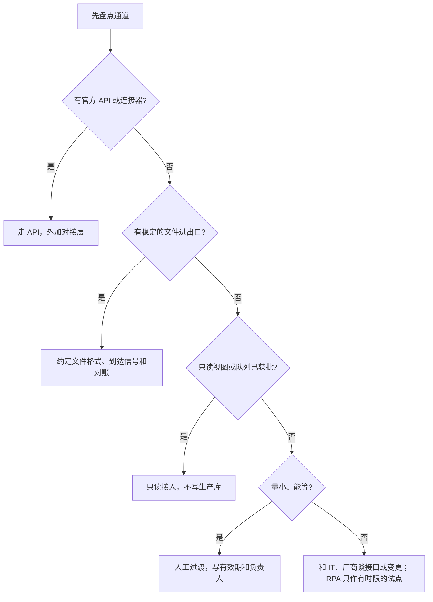

# 企业系统对接：CRM、ERP、内部系统，以及「没有 API 怎么办」

**FDE-16** · **2026-11-18** · Day 16 · **主题板块** 集成 · **难度** 入门到进阶

## 场景：「财务系统没有接口，是不是只能让机器人去点？」
物业报修项目继续（第 7 到 15 课）。夜间批次已经能给早会看板提供对过账的数字，乙的完工 Webhook 也能把「师傅到了」推到住户 App。

这周一，财务经理和客服主管一起找上门。财务要把已完工、已验收的工单做成应付账款，按承办商每周出一次账；客服希望住户的投诉和催办出现在他们的 CRM 里，避免前台和客服各记各的。还有一个用了十几年的前台管理系统，用来登记访客和临时出入许可，只有界面和「导出今日来访」。

会上有人说：「财务那套明年才有 API，先写个机器人对着屏幕点吧。前台系统也一样，每五分钟扫一次。」

这一课要讲清楚：**对接客户已有系统时，先盘点通道，再选接口、文件、只读视图还是人工过渡；没有 API 不是无路可走，也不是立刻上模拟点击。**

## 概念

### 企业里常见的三类系统
- **CRM**：客户或住户档案、跟进记录、投诉。客服团队每天开着它。
- **ERP**：财务、采购、应付/应收账款、库存。工单验收后要入账，走的是这里。
- **内部系统**：前台、门禁、自建工单库、旧的行业软件。香港不少物业、中小企业和公营机构都还在用这类系统。

FDE 很少从零做一套财务或 CRM，日常工作是把你交付的应用接到客户已经在用的系统上。第 9 到 15 课讲的 API、Webhook、认证、幂等、格式和管道，都是对接时的零件；这一课把零件装配成一条可交代的通道。

### 先盘点，再选通道
「没有 API」常常只是「还没人找过还有什么口」。动手前先问这几件事：

1. 有没有官方文档里的 API（REST、SOAP，有时是厂商的 SDK）
2. 有没有现成的连接器或付费集成模块（不少 ERP、CRM 把接口做成选配）
3. 能不能按约定导出、导入文件（CSV、XML，经 SFTP 或对象存储）
4. 内部系统能否提供只读视图或消息队列（要 IT 批准，且默认不写生产库）
5. 数量是否少到可以先人工过渡，并写明有效期和负责人

盘完再排序，不要跳到模拟点击（RPA：用脚本模仿人在界面上点选）。

### 各条通道会坏在哪

| 通道 | 适合 | 会坏在哪 |
|------|------|----------|
| 官方 API / 连接器 | 需要较新的状态、有文档、能申请到凭证 | 限流、版本变更、字段名字一样但含义不同 |
| 文件进出口 | 周结、月结、对账、对方只给导出 | 文件没到齐、编码或分隔符不一致、写到一半、没有删除事件 |
| 只读库或视图 | 内部系统、对方短期内不愿做接口 | schema 变更不通知、权限与审计、容易被请求去「顺便写一笔」 |
| 人工过渡 | 量小、先把流程跑通 | 不写有效期就会变成永久方案；人对了，系统对不上账 |
| 模拟点击（RPA） | 短期、低频、其它口都没有 | 界面一改就断、难对账、共用登录账号有安全风险 |

文件对接不是「退而求其次的 API」。对财务入账这类必须核对的事情，稳定的文件加对账，往往比一条不稳定的界面自动化更合适。做法沿用第 13 课和第 15 课：原始留档、校验、水位线、成功后再标记已处理、删除单独对账。给文件约定一个「到齐」信号（例如先写临时名，传完再改名，或另放一个标志文件），避免读到写到一半的文件。

### 对接层：把对方的特殊性挡在外面
不要让业务代码直接写「这个 ERP 字段」或「前台 Excel 第 C 列」。中间加一层对接层（常称防腐层）：对外翻译成你的标准模型，对内只认工单号、住户号、金额、状态这些稳定字段。还要写清每类数据以谁为准——住户电话以 CRM 为准，验收状态以工单系统为准，应付金额以财务入账为准。外部系统升级或改字段时，先改这一层，而不是改遍所有页面。重试和幂等沿用第 12 课，避免同一张完工单在 ERP 里入了两次账。

## 香港落地例子
三个系统可以这样切，不必用同一种办法：

- **CRM**：有文档齐全的 REST API，用 OAuth。工单关闭或住户催办时，经对接层调用 CRM 写入跟进记录。注意限流和第 11 课的凭证保管；CRM 不是工单主数据，状态仍以工单系统为准。
- **财务 ERP**：没有开放 API，明年才可能有。财务可以每周从系统导出对账表，也接受把应付文件放到他们的 SFTP，由会计审核后导入。已验收工单走第 15 课的批次，每周生成一份约定格式的文件，校验通过再投放；会计导入后的回执用来对账。官方应付数字以 ERP 入账为准，不把工单系统里的「待入账」直接当成已付款。
- **前台旧系统**：IT 暂不开放数据库，厂商只说「明年看情况出接口」。访客登记量不大，也不是住户 App 的关键路径。第一期用人工过渡：前台每日导出「今日来访」，按第 13 课校验后导入，写明有效期和下一次复查时间。不把每五分钟模拟点击写进正式范围；若以后量上来，再和 IT、厂商谈只读视图或付费接口。

给两位主管的说明可以很短：客服侧的跟进可以近实时进 CRM；财务侧每周一次文件对账，数字以 ERP 入账为准；前台先走每日导出，不在这一期上机器人。对接失败找谁、系统升级谁改接口，写进交付文档。

四类雇主的差异（对照即可）：

| 雇主类型 | 这件事上的侧重点 |
|----------|------------------|
| AI 原生 / 产品公司 | 产品里做成可复用的连接器抽象，优先官方 API 和文件两种；模拟点击不进产品主路径 |
| 大厂云与平台 | 先看有没有托管连接器或集成服务；没有再评估自建，并算清出站流量和运维责任 |
| 咨询与系统集成 | 对接矩阵、主数据归属、失败升级路径和系统升级由谁改，写进 SOW 让客户签字 |
| 甲方企业内部（如银行、保险、地产） | 跨系统写入通常要架构或变更评审；核心系统多半只出受控 API 或日终文件，项目组不直连生产库 |

## 面试怎么说
**题目**（公开面经里的常见问法类型）：「客户现有的 CRM 或 ERP 怎么对接？」或「对方系统没有 API，你怎么办？」

**答题思路**：先盘点再选型，不要一上来就说「上 RPA」。按官方 API 或连接器、约定文件、获批的只读视图、有时限的人工过渡来排；模拟点击只作为短期、低频、有退出条件的试点。中间做对接层，写清主数据以谁为准，调用要幂等，文件和对账要能重跑。最后补一句：通道的运维责任、凭证保管、系统升级谁来改，要写进交付约定，否则上线后第一周就会找不到人。

## 小练习
用 15 分钟，对着下面三个系统各选一条通道，并各写两条主要风险：

1. CRM：有文档化的 REST API，OAuth 2.0，限流每分钟 100 次，可以写跟进记录
2. ERP：只能每周导出 XML 对账表，并接受 SFTP 上的应付文件导入；没有删除事件
3. 门禁系统：厂商说「接口要等下一年度」，目前只有 Windows 界面，IT 未批数据库权限；进出记录一天大约几十条，安保希望门户上能看到「这人是否已授权进入」

写完后对照：第 1 个走 API 时，限流和「CRM 不是门禁或工单的主数据」怎么处理；第 2 个走文件时，「到齐」信号、删除或作废、对账回执怎么做；第 3 个为什么先考虑每日导出或人工过渡，而不是每五分钟模拟点击。

## 一句话带走
**没有 API 不是无路可走，也不是立刻上机器人。先盘点通道，用对接层挡住对方的特殊性；要对账的事，稳定的文件往往比模拟点击更合适。**

## 自测

1. 同事建议：前台系统每五分钟用机器人点一次「导出」并写入门户，这样访客名单就接近实时了。这样做有什么风险？你会怎么改建议？
2. 你在一家咨询与系统集成公司做 FDE，给一家中型保险公司做理赔门户。核心理赔系统没有开放 API，只有日终抽取文件。客户成功经理希望「保单持有人在门户里看到的理赔进度是实时的」。和物业报修相比，你在范围和通道选择上会怎么谈？

先用自己的话写两三句，再打开答案。

参考答案

**第 1 题**：主要风险是界面或按钮一改机器人就断；导出和导入很难做幂等和对账，可能重复或漏行；还常常要共用一个登录账号，凭证难管，出了问题也不好审计。接近实时并不是这批数据的真实需要——一天几十条访客、又不是住户 App 的关键路径。更稳妥的做法是：第一期改为每日（或每班次）由系统导出或前台导出，校验后导入，写明有效期；同时找 IT 或厂商要只读视图或正式接口。如果一定要试点机器人，也要限制频率、单独账号、失败告警和明确的退出日期，并且不把它当成正式的数据源。

**第 2 题**：先把「实时」拆开：门户上的进度能有多新，取决于源系统能提供什么。没有 API 时，日终文件可以支撑「截至昨天已确认的案件状态」，这和物业早会看板认对账批次是同一逻辑。若客户要「今日已受理 / 已补文件」这种当日状态，需要源系统提供事件、受控 API 或更频繁的抽取，这是范围变更，要评估安全评审、主数据归属（进度以核心系统为准）和对账口径，不能在门户里另算一套进度。咨询交付里要把通道、新鲜度 SLA、文件到达与重跑、升级由谁改，写进 SOW。不要为了「看起来实时」去模拟点击核心系统：理赔数据受《个人资料（私隐）条例》（PDPO）和内部审计约束，界面自动化难留审计、也难过安全评审。

系列：上一篇 · [ETL/数据管道：批 vs 流，增量同步](FDE-15-2026-11-17-集成-ETL数据管道批流增量同步.md) · 下一篇 · [LLM 基础：token、上下文窗口、温度、成本与延迟](FDE-17-2026-11-19-LLM应用-LLM基础token上下文窗口温度成本延迟.md) · [回到索引](README.md)
