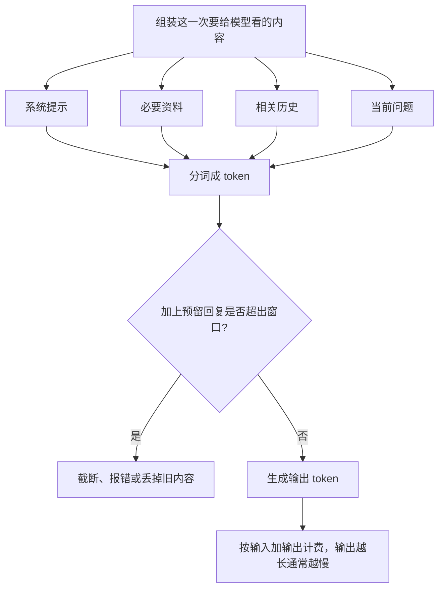

# LLM 基础：token、上下文窗口、温度、成本与延迟

**FDE-17** · **2026-11-19** · Day 17 · **主题板块** LLM 应用 · **难度** 入门

## 场景：「把三年工单都放进提示词，它不就什么都知道了？」
物业报修项目继续（第 7 到 16 课）。工单、CRM 和财务侧的通道已经谈妥，住户 App 也能看到「师傅到了」。这周客服主管希望再加一个「报修助手」：住户能查进度、问「渗水先做啥」，客服能让它起草给承办商的催办短讯。

会上有人说：「把三年工单和整本管理处手册都放进提示词，再把温度调高一点，回覆会更全面、也更生动。」

从这一课起进入 LLM 应用。先把计量单位和四条约束讲清楚：**模型按 token 计费和限长；上下文窗口是一次请求的工作记忆，不是长期记忆；温度不是准确度旋钮；成本和延迟主要由送进去的内容和生成长度决定。**

## 概念

### Token：计费和限长的单位
Token 是模型读写文本的计量单位，不是「一个字」也不是「一个词」。英文常见词往往一个 token，或被拆开；中文、数字、工单号、标点的切法取决于该模型的分词器。同一段中文，不要按字数或按英文经验去估。

输入（系统提示、资料、历史、当前问题）和输出（模型写出来的回复）都占 token。要知道一段文本占多少，用该模型的分词器或云厂商提供的计数接口，拿真实样例测，不要用页数拍脑袋。

### 上下文窗口：一次请求能看到的上限
上下文窗口是单次请求里模型能处理的 token 上限。通常要把系统提示、你塞进去的文档、对话历史、当前问题，以及预留给回复的长度算在一起。不同模型的窗口大小不一样，设计时查当前文档，不要假设「都能塞进去」。

超出窗口时，请求会失败，或旧内容被截掉。对话看起来像「忘了前面」，其实是那些内容已经不在窗口里。窗口也不是长期记忆：下一次请求默认看不到上一次窗口里的东西，除非你再送一遍。窗口变大，也不等于里面每一段都被同等注意到；把三年工单整份塞进去，中间那些单不一定帮得上忙，却每次都要再计一次费。

### 温度：随机程度，不是准确度
温度控制模型选词时有多「敢选不是最靠前的那个」。偏低时，同样的问题多次问，答案更稳；调高时，措辞更活，但也更容易偏离。

查工单状态、分类、抽取字段、要稳定格式的输出，用低温度。起草通知、给几个不同措辞的草稿，可以略高。调高温度不会让事实更准：问「师傅什么时候到」时调高，更容易把时间说错。

### 成本与延迟：先看送进去的，再看写出来的
费用通常按输入 token 加输出 token 算，输出的单价往往更高。对话每多一轮，常常要把历史再送一遍，所以「用户只问了一句」并不等于只计费几个字。系统提示和手册如果每次原样重贴，账单会跟着请求次数线性涨。

用户感受到的延迟，是「多久出现第一个字」加上「整段出完要多久」。生成往往一个 token 一个 token 往外写，回复越长越慢；输入很长时，处理输入也会变慢。住户问进度，要的是短而准；批量总结工单可以接受更长等待，甚至异步出结果。控制手段很具体：只放这一问需要的字段、给输出设上限、简单任务用更小的模型、能缓存的前缀（例如不变的系统提示）就缓存。

## 香港落地例子
报修助手可以按意图拆开，不必用同一种写法：

- **查进度**（「WO-3184 师傅到了没？」）：只向已对接的工单系统取这一张单的必要字段（单号、状态、预约时段），温度调低，输出限短。状态以工单系统为准，不让模型编一个到场时间。
- **标准问答**（「厕所地台渗水，我先可以做什么？」）：放一小段已经审过的标准说明，而不是整本手册。三年工单和整本手册都不该每次塞进提示词；需要哪一张单就取哪一张。按需取资料、避免整库塞进窗口，后面讲检索增强生成（[RAG](../ai-glossary/AI-02-RAG检索增强生成(RAG).md)）时会展开。
- **催办短讯草稿**：可以略高一点温度，出两三个措辞不同的草稿给客服选；工单号、约定上门时限这些字段仍从系统填入，不交给模型改。

给主管的说明可以很短：助手不是把三年历史装进脑子里；它每次只看这一问需要的几项。按预估的日问答量和真实样例的 token 数，先定一笔费用上限，超过就告警。查进度要快、要短；总结和草稿可以稍慢。

四类雇主的差异（对照即可）：

| 雇主类型 | 这件事上的侧重点 |
|----------|------------------|
| AI 原生 / 产品公司 | 按任务固定温度和输出上限，默认要有用量和延迟监控；把成本做成产品指标 |
| 大厂云与平台 | 先用平台的 token 计数、前缀缓存和不同价位的模型；向客户讲清按 token 计费和限流 |
| 咨询与系统集成 | 把窗口约束、温度策略、费用上限和延迟验收写进 SOW，避免「把全部知识放进模型」写进范围 |
| 甲方企业内部（如银行、保险、地产） | 对话是否出域、历史保留多久要过安全评审；用脱敏样例估 token；生产调用走已批准的通道 |

## 面试怎么说
**题目**（公开面经里的常见问法类型）：「什么是 token？上下文窗口对设计有什么影响？」或「怎么控制 LLM 应用的成本和延迟？温度怎么选？」

**答题思路**：先说 token 是计费和限长的单位，用真实文本和该模型的分词器计数，不要按字数估。窗口是单次请求的工作记忆，不是长期记忆，塞满不等于更准，也不等于模型会一直记住。温度按任务选：事实查询和结构化输出用低温度，探索性文案可以略高，它不是准确度旋钮。成本看输入加输出，历史和文档每次重送都要付钱；延迟看首字时间和回复长度，输出越长通常越慢。落到 FDE 的做法：用样例做预算，按意图限制上下文和输出，把费用上限和延迟验收写进范围。

## 小练习
用 15 分钟，为报修助手的三个意图各写四项：这一问要放进提示词的内容（尽量短）、温度偏低还是略高、要不要限制输出长度、主要的成本或延迟风险。

1. 住户问：「WO-3184 师傅到了没？」
2. 住户问：「厕所地台渗水，我先可以做什么？」
3. 客服要一封催承办商上门的短讯草稿，必须包含工单号和「明天中午前」这个时限

写完后对照：第 1 个是否只带了这一张单的字段、温度是否偏低；第 2 个有没有把整本手册塞进去；第 3 个可变的是措辞，还是连时限都交给模型改。

## 一句话带走
**Token 是计费和限长的单位，窗口是一次请求的工作记忆。不要把全部历史塞进去，也不要用温度去「提高准确性」；成本和延迟，先看你送进去什么、再看你让它写多长。**

## 自测

1. 同事建议：把三年工单和整本管理处手册每次都放进系统提示，并把温度调高，「这样既全面又生动」。这样做有什么问题？你会怎么改建议？
2. 你在一家大厂云与平台做 FDE，客户要用你们的托管模型做银行零售客服助手，查账户变动并起草短信通知。和物业报修相比，你在窗口、温度、成本和延迟上会怎么谈？

先用自己的话写两三句，再打开答案。

参考答案

**第 1 题**：三年工单加整本手册，很可能逼近或超出上下文窗口；就算塞得进去，每次提问都要把同样的大段文本再送一遍，费用会按请求次数累加，窗口中间的内容也不一定被用上。温度调高不会让进度和手册内容更准，反而更容易把时间、单号说错，回覆也会变长、更慢。应改成按意图组装上下文：查进度只取这一张工单的必要字段，温度调低、限制输出长度；标准问答只放已审过的相应说明；需要历史时再按单号去工单系统取，而不是整库塞进提示词。费用按真实样例的 token 和预估日量设上限。

**第 2 题**：银行零售客服比物业报修更不能「生动发挥」。查账户变动属于事实查询，温度要低，余额和变动必须以核心系统（或已批准的只读接口）为准，不能靠模型回忆或编造；短信里的金额、时间和账号只从系统填入。窗口里只放这一次查询需要的字段，对话历史要按银行的保留和出域规定处理，不能默认把长聊天记录一直重送。成本和延迟要按平台的 token 计费、限流和缓存来讲清楚：查询类答复要短、要快（可订首字或整段时限）；草稿可以稍慢，但仍要有输出上限。生产调用走托管通道和已批准的数据范围，用脱敏样例先做 token 估算，再写进费用和验收约定。

## 延伸观看
- [Why AI Tokens are so Expensive](https://www.youtube.com/watch?v=-0HRzXk8vlk)（Computerphile）：从「token 是什么」讲到为何按 token 计费会迅速变贵，适合和本课的成本、窗口约束一起看。

系列：上一篇 · [企业系统对接：CRM、ERP、内部系统，以及「没有 API 怎么办」](FDE-16-2026-11-18-集成-企业系统对接CRM-ERP无API.md) · 下一篇 · [Prompt 工程：结构化输出、few-shot、系统提示](FDE-18-2026-11-20-LLM应用-Prompt工程结构化输出few-shot系统提示.md) · [回到索引](README.md)
