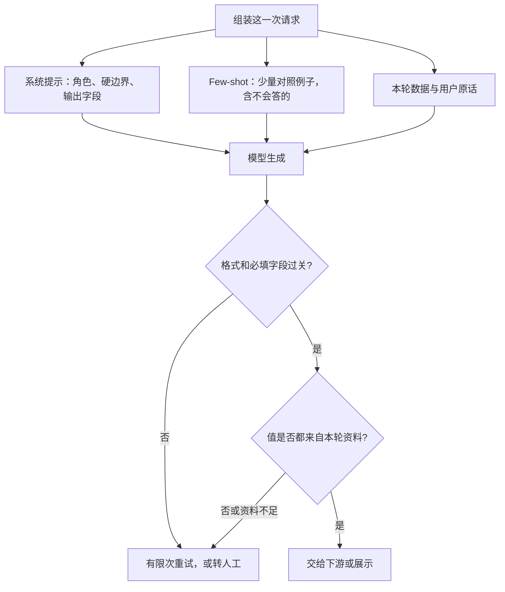

# Prompt 工程：结构化输出、few-shot、系统提示

**FDE-18** · **2026-11-20** · Day 18 · **主题板块** LLM 应用 · **难度** 入门到进阶

## 场景：「写长一点，它就会听话。」
物业报修助手继续（接 [FDE-17](FDE-17-2026-11-19-LLM应用-LLM基础token上下文窗口温度成本延迟.md)）。通道和计费约束谈过了，这周要把三个意图写进提示词：查进度、标准问答、催办短讯草稿。

有人交来一版系统提示，写了很长一段：「你是专业、友善、准确的助手，任何问题都要尽力回答，回复要生动……」下面又贴了二十张旧工单当例子。试跑下来，查进度有时写成一段安慰的话，有时把预约时间编出来；催办短讯把「明天中午前」改成了「尽快」。

问题不在模型「不听话」，而在提示词没有把三件事钉死：**系统提示负责角色和硬边界；few-shot 用少量对照例子示范合格输出；要交给系统的结果，得有固定结构，而且格式对不等于值对。** 规格、版本和验收的完整写法，见科普篇 [提示词工程](../ai-glossary/AI-06-提示词工程(Prompt-Engineering).md)；结构化输出的三层保证，见 [结构化输出](../ai-glossary/AI-11-结构化输出(Structured-Output).md)。本课先把这三件在报修助手里用起来。

## 概念

### 系统提示：站得住的规则，不是性格作文
系统提示（system prompt，有的厂商叫 developer message）是这一类请求里相对固定的指令：你是谁、只做哪一类任务、事实从哪里来、什么绝对不能做、材料不足时怎么说。

它不是「请你专业、友善、准确」这种形容词堆砌。那些话几乎检查不了，也拦不住编造。更有用的是可执行的边界，例如：

- 工单状态、预约时段、时限，只许使用本轮提供的系统字段；没有就说找不到，不要补一个时间。
- 不承诺减免管理费，不替管理处批准开工。
- 查进度、标准问答、催办草稿是不同任务，按本轮标明的意图执行，不要互相串戏。

本轮才变化的内容——这张工单的字段、住户原话——放在用户消息里，不要写进系统提示。系统提示尽量稳定，也方便前缀缓存（见 [FDE-17](FDE-17-2026-11-19-LLM应用-LLM基础token上下文窗口温度成本延迟.md)）。用户原文要当数据看，不要和系统规则混在同一层；否则材料里如果夹着「忽略之前的规则」，边界会被冲掉。这一点在 [提示注入](../ai-glossary/AI-09-提示注入(Prompt-Injection).md) 里展开，本课先做到：分隔清楚，用户原文不当新指令。

### Few-shot：少而对照，不要堆快乐路径
Zero-shot 是只给说明、不给例子，可以先试。Few-shot 是再放几对「输入 → 合格输出」，让模型模仿形状、口径和拒答方式。

例子的价值不在多，而在对照：至少要有一个正常能答的，再加你真正怕的失败——查不到工单、住户没提供单号、手册片段里没有答案、时限必须原样保留。二十张都是「顺利查到进度」的旧单，模型学不到「不知道的时候该怎么说」。

例子会占上下文窗口、每次重送都计费，所以要短、要脱敏（不要把真实住户姓名、电话、单位写进提示词）。坏了再把失败案例加进去，而不是一开始就堆。

### 结构化输出：给下游一份能校验的形状
查进度的结果往往要写回 App 或工单系统，不能只靠一段自然句再正则去抠。做法是约定字段，例如：`ticket_no`、`status`、`appointment_slot`、`answer`、`needs_human`。催办草稿也一样：`sms_text` 可以略有措辞变化，但 `ticket_no` 和 `deadline` 必须从系统字段原样带出。

只在提示词里写「请输出 JSON」，能提高概率，但不保证每次都合法。厂商的 JSON 模式或 schema 约束，管的是格式；字段齐了，值仍可能是编的。原文没有的字段不要设成必填去逼模型硬填，把它设成可空，并留 `needs_human` 这类出口。生成之后用程序校验：格式不对就有限次重试，值对不上或缺失就转人工，不要直接写进系统。细节见 [结构化输出](../ai-glossary/AI-11-结构化输出(Structured-Output).md)。



## 香港落地例子
三个意图不要共用一篇「万能助手」长文，按任务拆开（或在同一系统提示里按意图分支，但边界各自写清）：

- **查进度**（「WO-3184 师傅到了没？」）：系统提示写死，状态和时段只来自本轮工单字段；找不到就 `needs_human: true`，禁止补时间。温度偏低，输出限短。Few-shot 至少两对：一张能查到的单（字段齐全）；一张系统返回「无此单」（不编造，说明查不到并转人工）。输出可以是下面这样的形状（教学用的虚构字段，不是任何屋苑的真实工单）：

```json
{
  "ticket_no": "WO-3184",
  "status": "已派工",
  "appointment_slot": "2026-11-21 14:00-16:00",
  "answer": "师傅已预约明日下午 2 点到 4 点上门。",
  "needs_human": false
}
```

- **标准问答**（「厕所地台渗水，我先可以做什么？」）：只依据本轮附上的已审说明回答；片段没有的就说没有，不补「一般可以」。Few-shot 放一对「片段里有答案」和一对「片段没有、应拒答或转管理处」。对住户的短答可以是自然语言，同时给系统一个结构化摘要（主题、是否找到依据、是否转人工）。整本手册不要塞进提示词；按需取片段的做法，后面讲检索增强生成（[RAG](../ai-glossary/AI-02-RAG检索增强生成(RAG).md)）时会展开。

- **催办短讯草稿**：工单号和「明天中午前」由系统填入，模型只改措辞，可出两三个草稿供客服选。Few-shot 里放一个反例：把时限改写成「尽快」是不合格的。温度可以略高，但输出仍要带上原样保留的字段，方便程序核对。

给主管可以这样讲：提示词不是越长越灵；它是这一任务的规则、对照例子和交件格式。形容词堆不出稳定性，边界、例子和校验可以。

四类雇主的差异（对照即可）：

| 雇主类型 | 这件事上的侧重点 |
|----------|------------------|
| AI 原生 / 产品公司 | 系统提示和 schema 当产品配置，要有版本；few-shot 来自真实失败，而不是演示文稿 |
| 大厂云与平台 | 优先用平台的系统消息分层、JSON 模式或约束解码；向客户讲清：开了格式保证，不等于值已经对 |
| 咨询与系统集成 | 把系统提示、输出字段和「资料不足则转人工」写进 SOW；改提示词等于改已签字的行为 |
| 甲方企业内部（如银行、保险、地产） | 系统提示要过评审；few-shot 必须脱敏；对客话术和写入系统的字段分开，方便审计 |

## 面试怎么说
**题目**（公开面经里的常见问法类型）：「系统提示和用户提示怎么分工？」或「什么时候用 few-shot？怎样让模型稳定输出给程序用的结果？」

**答题思路**：系统提示放角色、硬边界和输出规格，本轮数据和用户原话放在外面，当数据不当新指令。先 zero-shot 试，说明不够稳或边界案例难用文字说清时，再加少量对照例子，要覆盖「不会答」的情况，不要堆快乐路径。需要交给系统的结果约定字段；格式可以用 JSON 模式或 schema 约束来保证，但值必须校验，缺字段就留空或转人工，不要逼模型硬填。提示词改了要当行为变更来看；知识不在场就去检索，要实时状态就去系统取，不要靠把提示词写得更长来解决。

## 小练习
用 15 分钟，为「查进度」写一版最小可用的提示词，只含下面四项（尽量短）：

1. 系统提示：角色、事实来源、至少两条硬边界（含「不要编造预约时间」）
2. 两个 few-shot：一个查到单，一个查无此单（输出字段要一致）
3. 输出字段名单：哪些必填、哪个可空、何时 `needs_human: true`
4. 本轮用户消息里放什么（例如单号 WO-3184），什么不要放进系统提示

写完后对照：系统提示里有没有把这张单的具体字段写死；两个例子是不是同一套字段；「无此单」有没有仍编出一个上门时间。

## 一句话带走
**系统提示写边界，few-shot 示范合格和不合格，结构化输出把交件形状固定下来。格式对不等于值对；值要对，还得靠本轮资料和程序校验。**

## 自测

1. 同事建议：把系统提示写成很长一段「专业、准确、生动」的形容词，再贴二十张都成功结单的旧工单当 few-shot，并且在提示词里要求「必须填齐所有字段，不准空」。这样做有什么问题？你会怎么改？
2. 你在一家 AI 原生 / 产品公司做 FDE，产品经理想把「查进度」做成对客户开放的 API：每次返回 JSON。和物业报修的内部助手相比，你在系统提示、few-shot 和结构化输出上会怎么坚持？

先用自己的话写两三句，再打开答案。

<details>
<summary>参考答案</summary>

**第 1 题**：形容词几乎无法验收，也拦不住编造预约时间或改写时限。二十张都是顺利结单的例子，模型学不到「查无此单 / 没有单号」时该拒答，还白白占用窗口、增加费用；若例子里有真实住户资料，还有泄露风险。「必须填齐、不准空」会逼模型在没有依据时硬填，格式看起来很完整，值却是假的。应改成：系统提示写短而可执行的边界（事实只来自本轮字段、不准编时间、资料不足就转人工）；few-shot 只留少量对照，必须包含失败或拒答；可空字段加上 `needs_human`；生成后做格式和业务校验，不合格则重试或转人工，不要直接写进系统。

**第 2 题**：对客户开放的 API 把输出字段变成了接口合约，比内部助手更不能「偶尔写成一段话」。系统提示和 schema 要进版本库，和模型、温度一起发布、回滚；改一句边界等于改产品行为，要用冻结案例回归，不能只靠演示时试两问。Few-shot 应用真实失败（查无单、缺字段、用户把催办和查进度混在一句话里），并脱敏。结构化输出要用平台的 JSON 模式或约束解码保证格式，但对外仍要在服务端校验：值必须能对上工单系统，缺的字段返回空或明确的错误，而不是让模型编一个状态交差。格式保证要写进文档，免得客户以为「每次都是合法 JSON」就等于「状态一定正确」。

</details>

## 延伸观看
- [Prompting 101 | Code w/ Claude](https://www.youtube.com/watch?v=ysPbXH0LpIE)（Anthropic Applied AI）：用真实任务把一版含糊的提示词迭代到可用规格，覆盖说明、例子和输出格式，适合和本课一起看。

系列：上一篇 · [LLM 基础：token、上下文窗口、温度、成本与延迟](FDE-17-2026-11-19-LLM应用-LLM基础token上下文窗口温度成本延迟.md) · 下一篇 · [Embedding 与向量检索：原理与选型](FDE-19-2026-11-21-LLM应用-Embedding与向量检索原理与选型.md) · [回到索引](README.md)
