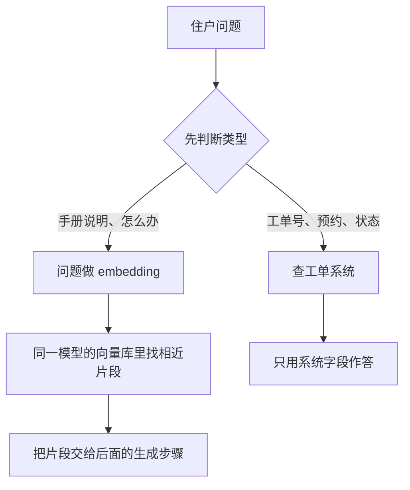

# Embedding 与向量检索：原理与选型

**FDE-19** · **2026-11-21** · Day 19 · **主题板块** LLM 应用 · **难度** 入门到进阶

## 场景：「丢进向量库，一问就能搜出来。」
物业报修助手继续（接 [FDE-18](FDE-18-2026-11-20-LLM应用-Prompt工程结构化输出few-shot系统提示.md)）。提示词的边界谈过了，标准问答却不能把整本手册塞进窗口：又贵，要点还容易被淹没（见 [FDE-17](FDE-17-2026-11-19-LLM应用-LLM基础token上下文窗口温度成本延迟.md)）。

有人说：把手册丢进向量库，住户怎么问都能「按意思」搜到。试跑下来，「厕所地台渗水，我先可以做什么？」确实对上了「渗漏应急处理」；但「WO-3184 师傅到了没？」也去搜手册，工单号被当成一句普通的话，搜出一堆「承办商到场时限」条文。中英夹杂的「sink leak 点算」，有时又对不上只按书面中文建好的索引。

问题不在「要不要向量库」，而在还没分清三件事：**embedding 把文字变成可比较的向量；向量检索找的是意思上接近的片段，不是精确编号；选型要先定模型、度量和过滤，再谈放哪家库。** 检索找错了怎么查，科普篇 [嵌入与向量检索](../ai-glossary/AI-08-嵌入与向量检索(Embedding).md) 写得更细。整段「取片段再生成、再引用」的流程，下一课讲 [RAG](../ai-glossary/AI-02-RAG检索增强生成(RAG).md)。本课先在报修助手里把原理和选型用起来。

## 概念

### 先有一个地图直觉
把每一段已审说明钉在一张地图上：意思相近的段落靠得近。住户的问题也钉一个点，然后找附近的钉子。这不是「有没有这个词」，而是「方向是否接近」。

Embedding（嵌入）就是那个钉钉子的动作：用一个模型把一段文字变成固定长度的一串数字，也就是向量。同一模型眼里，「地台渗水」和「地板漏水怎么办」通常会靠得很近，即使用词不同。

向量本身没有人能直接读的「意思」，不能拿来当审计记录。换一个模型，坐标轴就变了，新旧数字不能放在一起比。所以：**建索引和查询必须用同一个 embedding 模型**（或厂商保证兼容的同一家族）；换模型就要整库重做。

### 向量检索怎么工作
预先把手册切成片段（怎么切、切多大，下一课再讲），每段算一个向量存起来。用户一问，用同一个模型把问题也编成向量，在库里找最近的 k 条。常用余弦相似度或内积；度量要跟模型说明走，不要混用。

找回来的是「在这个模型里看起来像」的片段，不是「这段一定能当答案」。后面要不要送给模型生成、如何引用、找不到时怎么停，都是 [RAG](../ai-glossary/AI-02-RAG检索增强生成(RAG).md) 的事。本课先停在：先找对片段。

关键词检索（如 BM25）正好互补：它擅长工单号、条款编号、物料型号这种精确字面；向量检索擅长换一种说法。香港的手册和住户问法经常混着书面中文、粤语口语和英文，两路往往要一起用，而不是互相替换。

### 会在哪里坏，选型看什么
常见坏法：只用向量去搜工单号，被「相近的字」带去手册；只用关键词，粤语口语和同义说法召不回；文档更新了却没重嵌；手册是书面中文，问法是粤语或中英混杂，模型没在这些问法上量过；把「搜到了」当成「答对了」。

选型不必先纠结向量库存哪一家。先能讲清这几件事：

- **模型**：是否覆盖书面中文、英文，以及真实会遇到的粤语口语、中英混杂；维度、费用和延迟是否可接受。用真实问法抽检，不要只拿和原文几乎一样的书面题做演示。
- **一致**：查询模型和入库模型是同一个；度量与模型匹配。
- **存放**：向量和原文能不能出客户环境；已有 Postgres 时，pgvector 往往够起步；出域要过安全评审。
- **过滤**：按屋苑、手册版本、生效日期过滤，避免搜到过期条文。过滤要在取前 k 条时就生效，不要先搜完全库再丢。
- **路由**：工单号、实时状态走系统查询；条款编号、型号可走关键词；说明类问题走向量。路由清楚，比「全部语义化」更重要。

不要为了演示换最新模型，却不重建、不回归。能讲清为什么选这个模型、文档变了怎么更新、失败时怎么转人工，才算选型做完。

## 香港落地例子
继续报修助手的「标准问答」和「查进度」，把问法先分流，再谈库。

- 住户问「厕所地台渗水，我先可以做什么？」：这是说明类问题，向量检索应召回已审的「渗漏应急」（关水阀、拍照、避免触电）之类片段，而不是催办流程，也不是某张旧工单的处理记录。
- 住户问「WO-3184 师傅到了没？」：这是查进度，应走工单系统（[FDE-18](FDE-18-2026-11-20-LLM应用-Prompt工程结构化输出few-shot系统提示.md)），不要先嵌入再搜手册。工单号不是「意思上接近」能解决的。
- 住户说「sink leak 点算」或「地台漏紧水」：用这类真实问法抽检。若模型只对书面普通话近、对粤语和中英混杂远，就换在这些问法上量过的模型，并整库重嵌；也可以在索引里加入已审的口语同义问法，但仍要人工审过，不能把住户原话未经审核就写进知识库。

给主管可以这样讲：向量库不是把手册「教会」模型，只是按意思取出几段已审说明。取片段的质量，决定后面生成有没有依据。工单、编号和实时状态，仍然走系统。

四类雇主的差异（对照即可）：

| 雇主类型 | 这件事上的侧重点 |
|----------|------------------|
| AI 原生 / 产品公司 | 模型、索引和过滤是产品配置，要有版本；用真实失败问法回归，而不是演示里的书面题 |
| 大厂云与平台 | 优先讲清托管检索的出域范围、模型和度量是否绑定；客户换模型要整库重嵌，不能只改调用 |
| 咨询与系统集成 | 把「何种问法走系统 / 关键词 / 向量」、数据是否出域、更新和重建写进 SOW；换库不等于换完选型 |
| 甲方企业内部（如银行、保险、地产） | 原文和向量的存放要过评审；按产品或屋苑、版本过滤；过期手册不能和现行版混在一个可检索范围里 |

## 面试怎么说
**题目**（公开面经里的常见问法类型）：「embedding 和关键词检索有什么差别？」或「怎么选 embedding 模型？为什么语义搜索还会找错？」

**答题思路**：embedding 把文本变成向量，方向接近表示在这个模型里意思相近；关键词做精确匹配。两者互补，不是互相替代。选型先看语言覆盖、入库和查询是否同一模型、数据能否出域、有没有版本和权限过滤，再选存放方式。语义搜索找错，常见于问法和索引语言不一致、精确编号被向量带偏、文档更新后没重嵌，或过期条文没被过滤掉。会说明何时走系统查询或关键词，而不是把所有问题都丢进向量库。找错了怎么拆检索层，见 [嵌入与向量检索](../ai-glossary/AI-08-嵌入与向量检索(Embedding).md)。

## 小练习
用 15 分钟，为报修助手列一张「检索路由」草稿。写下至少 6 条真实可能出现的问法，其中要包含：一张工单号、一句书面中文说明、一句粤语口语、一句中英混杂、一条可能命中过期手册的问法。每条标明走「系统查询 / 关键词 / 向量 / 转人工」，并写你打算用来抽检的一条失败（例如搜到了过期「临时停水通知」）。

写完后对照：工单号有没有仍去搜手册；口语和中英混杂有没有只拿书面题代替；过期条文有没有靠「搜完再人工看」而不是检索时过滤。

## 一句话带走
**向量检索找的是意思上接近的片段，不是把手册装进模型里。** 工单号和实时状态走系统，说明类问题才用 embedding；模型和度量要一致，文档变了要重嵌。

## 自测

1. 同事建议：把工单库和整本手册一起嵌入同一个向量库，所有问题都做语义搜索，「这样什么都能搜到」。这样做有什么问题？你会怎么改？
2. 你在一家咨询与系统集成公司做 FDE，要为银行客户的内部政策助手选检索方案。和物业报修的内部助手相比，你在模型、出域和更新上会怎么坚持？

先用自己的话写两三句，再打开答案。

参考答案

**第 1 题**：工单状态和预约时间是会变的系统事实，不该靠「意思接近」去搜历史工单或手册条文；工单号被向量看成普通句子，容易搜出「到场时限」这类只是用词相近的说明。手册和工单混在一个库里，还可能把旧工单处理记录当成现行做法召回。应改成先路由：查进度走工单系统；条款号或物料型号走关键词；说明类问题才走向量，并按手册版本和生效日期过滤。两路可以合并，但不能用一个语义搜索代替系统查询。

**第 2 题**：银行内部政策比物业手册更不能出域、更不能混版。模型和索引要留在已批准的环境里，托管检索要先讲清原文和向量是否出客户范围。入库和查询必须是同一模型，换模型就要整库重嵌、重建，再用含条款号、粤语和中英混杂的问法回归，不能只靠演示。政策会改版，检索时按产品线和生效版本过滤，停用版本默认不进候选。这些要写进范围和交接，而不是「先上一个向量库再说」。

## 延伸观看
- [What is a Vector Database? Powering Semantic Search & AI Applications](https://www.youtube.com/watch?v=gl1r1XV0SLw)（IBM Technology）：从 embedding 讲到相似检索，适合和本课的「找相近片段」一起看。
- [Word Embedding and Word2Vec, Clearly Explained!!!](https://www.youtube.com/watch?v=viZrOnJclY0)（StatQuest）：把「相近的意思用相近的数字表示」讲清楚；本课用的是整段文本的 embedding，不是一词一向量，但这个直觉是通的。

系列：上一篇 · [Prompt 工程：结构化输出、few-shot、系统提示](FDE-18-2026-11-20-LLM应用-Prompt工程结构化输出few-shot系统提示.md) · [回到索引](README.md)
