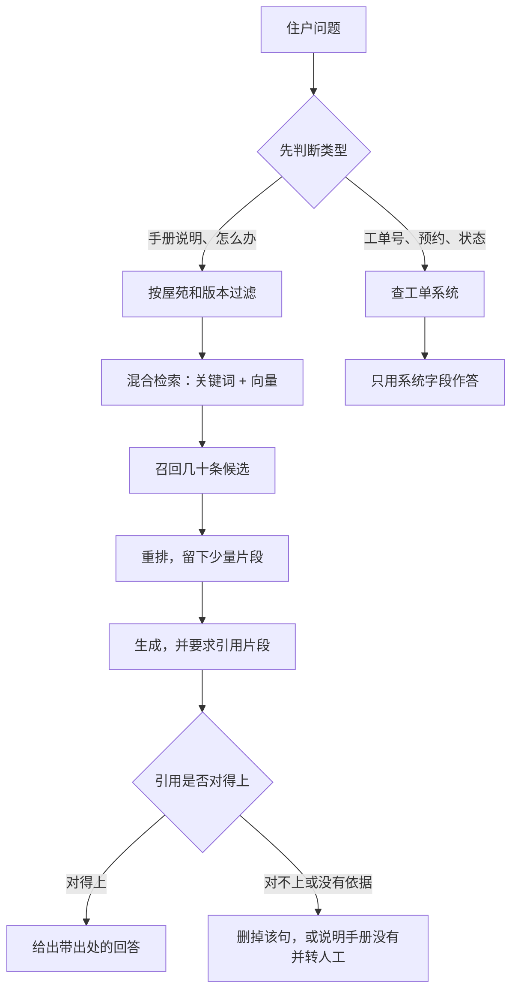

# RAG 全流程：切块、召回、重排、引用

**FDE-20** · **2026-11-22** · Day 20 · **主题板块** LLM 应用 · **难度** 入门到进阶

## 场景：「搜几段，模型自然会答对。」
物业报修助手继续（接 [FDE-19](FDE-19-2026-11-21-LLM应用-Embedding与向量检索原理与选型.md)）。向量检索能按意思取出相近片段之后，有人说：取前 5 段丢给模型就行。试跑「厕所地台渗水，我先可以做什么？」看起来顺利，住户也听到了「先关角阀、拍照」。

再换几问，裂缝就出来了。「若涉及公共立管，先报管理处，不要关总阀」被切到下一块，模型只看到前半，便叫人去关大厦总阀。「sink leak 点算」召回的是泛泛的供水介绍，关键的「渗漏应急」根本没进候选。候选一多，过期的「临时停水通知」和承办商时限条文挤在一起，模型挑了句好听的，写出「24 小时内必须上门」——手册现行页里并没有这个时限。

问题不在「要不要 RAG」，而在还没把整条链路走完：**切块决定对的内容能不能被找到；召回先求找得到；重排再求少而准；引用要求每句结论都对得上片段，对不上就停。** 检索层的原理和选型见上一课；这条「取片段再生成、再引用」的流程，科普篇 [RAG 检索增强生成](../ai-glossary/AI-02-RAG检索增强生成(RAG).md) 写得更细。本课先在报修助手里把四个步骤用起来。答错了怎么逐段排查，下一课再讲。

## 概念

### 先有一个卷宗直觉
不要把整本手册塞进窗口（见 [FDE-17](FDE-17-2026-11-19-LLM应用-LLM基础token上下文窗口温度成本延迟.md)）。像给新值班员准备卷宗：先按章节复印单页（切块），多抽几页以免漏掉关键例外（召回），再只留下真正回答这个问题的几页（重排）。值班员只能根据这些页来写，并且注明页码（引用）。页上没有的，就说「手册里没有」，而不是凭记忆补一句。

RAG（Retrieval-Augmented Generation，检索增强生成）就是这件事：先从指定资料里取出相关片段，放进提示词，再让模型依据这些片段回答。它不是把手册「教会」模型，也不是搜到了就等于答对了。

### 四个步骤怎么接起来
离线先把已审手册切成带元数据的块（来源、标题路径、版本、屋苑、生效日期），再建关键词索引和向量索引。在线则是一次请求的流水线：

工单号和实时状态仍然走系统，不走这条链路，上一课的路由在这里继续有效。

**切块。** 按文档结构切：一条规程、它的例外、一张表，尽量各成一块，比固定字数一刀切更稳。「但是」「若」后面的例外要和前面的规则留在一起，或至少有重叠，避免模型只看到半段。每块带上标题路径和版本，引用时才能说清出处。表格和扫描件要单独处理，解析质量往往比后面换模型更影响效果。

**召回。** 第一轮追求的是：对的块有没有出现在前几十条里。关键词检索稳住工单号、条款号、物料型号；向量检索接住换一种说法、粤语口语和中英混杂（见 [FDE-19](FDE-19-2026-11-21-LLM应用-Embedding与向量检索原理与选型.md)）。两路一起查，再合并排序。问法和书面标题差得远时，可以先做查询改写，或在索引里加入已审的口语同义问法。搜到了不等于搜对了：要看该在的那一块在不在候选里。

**重排。** 第一轮刻意多取，是怕漏；真正送给模型的只能是少量最相关的块。重排把问题和每个候选放在一起打分，留下几条。片段少而准，通常比「多贴一些保险」更好：上下文更短，费用和延迟更低，模型也不容易在一长串片段中间把关键例外忽略掉。过期条文应在检索时按生效日期滤掉，不要指望重排或事后再看。

**引用（grounding）。** 提示词要求每句结论标出片段编号；生成后再核对：被引用的片段里，是否真有这句话的依据。没有就删掉这句，或整体回答「手册里没有」。这就是 grounding：答案锚在取回的证据上，而不是模型的记忆。「看起来像引用」不等于「片段里有这个事实」。

权限和版本过滤要发生在取候选时，不能等生成后再挡。片段一旦进了提示词，就可能被说出来。这一层怎么做成硬条件，见 [权限感知检索](../ai-glossary/AI-17-权限感知检索(Permission-aware-Retrieval).md)。

## 香港落地例子
继续报修助手的「标准问答」。下面是一页虚构的现行说明，后面的练习也会用到它。

> **渗漏应急处理（现行版）**
> 1. 单元内水龙头或地台渗水：先关闭该单元角阀，切断附近电源，拍照取证，并避免触摸积水。
> 2. 若渗水可能来自公共立管或楼上邻居，先报管理处和当值保安，不要自行关闭大厦总阀。
> 3. 管理处登记后按紧急程度派单。非紧急报修的到场时限见《承办商服务合约》，本页不规定具体小时数。

如果按固定字数把第 1 条和第 2 条切开，住户问「地台漏水我先关总掣得唔得」，模型可能只看到「先关阀」，给出危险建议。正确切法是：应急步骤和「不要关总阀」这条例外留在同一块，或中间留重叠，并且块上带着「渗漏应急 / 现行版」这条路径。

召回要用真实问法抽检。「厕所地台渗水，我先可以做什么？」应命中这一块；「sink leak 点算」「地台漏紧水」也应命中，不能只拿和原文几乎一样的书面题做演示。若书面标题召不回口语问法，就改查询改写或补已审的同义问法，而不是把 k 调得很大碰运气。「WO-3184 师傅到了没？」仍然走工单系统，不要送进 RAG。

重排要在混合检索之后做。候选里可能同时出现「渗漏应急」、承办商到场时限，以及一张已失效的「台风后临时安排：非紧急报修 24 小时内到场」。现行块应留下，「24 小时」那张不应进提示词——失效日期要在过滤阶段就生效，不能靠模型自己判断哪张过期。

引用是对主管能讲清楚的那一层。合适的回答是：「先关该单元角阀，拍照，不要关大厦总阀。[手册·渗漏应急·现行版]」。如果模型想写「24 小时内上门」，而现行页只说时限见合约、本页不写小时数，就应删掉这句，或改口「手册这一页没有写到场时限，请转管理处」。演示能答对，不等于引用核对已经做了。

四类雇主的差异（对照即可）：

| 雇主类型 | 这件事上的侧重点 |
|----------|------------------|
| AI 原生 / 产品公司 | 切块、检索、重排和引用核对是带版本的产品配置；要用真实失败问法回归，而不是演示里的书面题 |
| 大厂云与平台 | 讲清托管知识库里切块和过滤发生在哪一层、引用能否链回客户原文；客户改切法或模型，要能重建并回归 |
| 咨询与系统集成 | 把切块规则、混合检索、引用核对和「无依据就停」写进范围；资料清洗和版本治理往往比调模型更占工时 |
| 甲方企业内部（如银行、保险、地产） | 原文不出未经批准的环境；按产品线或屋苑、生效版本过滤；每句结论要能翻回条款，答不出就转人工 |

## 面试怎么说
**题目**（公开面经里的常见问法类型）：「介绍一下你怎么做 RAG。」或「怎么切块？怎么保证回答是有依据的？」

**答题思路**：按一条链路讲，不要停在「先检索再生成」。离线按结构切块，规则和例外放在一起，并带上标题路径和版本。在线先过滤，再混合检索做召回，重排后只留少量片段。生成时每句结论要能对上引用的片段，对不上就删或拒答。工单号和实时状态走系统，不走 RAG。答错时先看对的块在不在候选里，再看模型有没有用上，再看是不是用记忆补了——详细排查下一课再展开。

**可以这样说**：

> "I would walk through the full pipeline, not just search-then-generate. Offline, I chunk by document structure so a rule and its exception stay together, and each chunk carries a heading path, version, and effective date. Online, I filter first, then run hybrid retrieval for recall: BM25 for IDs and clause numbers, embeddings for paraphrases, keeping a few dozen candidates. A reranker then leaves only a small set of chunks; stuffing many into the context costs more and the model may miss the exception in the middle. Generation has to be grounded: every claim cites a chunk, and I check that the cited text actually supports that sentence. If it doesn't, I drop the claim or say the handbook doesn't cover it. Ticket numbers and live status still go to the system of record, not RAG."

用客户习惯的语言（粤语或普通话）把这四个步骤讲完，强调对不上依据就停；用英文把同一套步骤写进方案。

## 小练习
用 15 分钟，只针对上面那页「渗漏应急处理（现行版）」做一版最小设计。写下：

1. 你会切成几块、每一块包含哪几条，以及第 2 条例外为什么不能单独掉到下一块。
2. 三条问法：「厕所地台渗水，我先可以做什么？」「sink leak 点算」「地台漏水我可唔可以关总掣？」——每一条应对上哪一块。
3. 一句不能生成的话：例如「非紧急报修 24 小时内必须上门」。写明现行页里哪一句说明它没有依据，以及系统应如何收口（删句、声明没有、或转管理处）。

写完后对照：例外有没有和规则切散；口语和中英混杂有没有只拿书面题代替；「24 小时」是不是仍可能从过期通知混进提示词。

## 一句话带走
**RAG 不是「搜几段再让模型发挥」。** 切块让对的内容能被找到，召回先求找得到，重排再求少而准，引用要求每句都对得上片段；对不上就停。

## 自测

1. 同事建议：把取回的片段从 5 条加到 40 条，「上下文多一些更保险」，同时先不上重排，也不做引用核对，等用户投诉再说。这样做有什么问题？你会怎么改？
2. 你在一家大厂云与平台做 FDE，要帮银行客户落地托管知识库。和物业报修的内部助手相比，你在切块、引用和过滤上会怎么坚持？

先用自己的话写两三句，再打开答案。

参考答案

**第 1 题**：多贴片段不等于更准。不相关或过期的条文进了提示词，模型更容易挑一句好听的来说；关键例外若夹在中间，反而可能被忽略。费用和延迟也会随输入变长而上升。应保持「先召回再重排」：第一轮可以多取，送给模型的只留少量最相关、且已按版本过滤的块。生成后还要核对引用，片段里没有的时限或承诺必须删掉或改为「手册没有，转人工」。用户投诉太晚，演示当时就会把错答当成成功。

**第 2 题**：托管知识库要先讲清切块、过滤和引用发生在平台的哪一层，原文和向量是否出客户范围。银行政策比物业手册更不能混版、更需要每句能翻回条款。按产品线和生效版本在检索时过滤，停用版本默认不进候选；引用要能链回客户侧的条款，而不能只是一段无法核对的摘要。客户改切法或换模型，要能重建索引并用含条款号、口语和「资料里没有」的题回归。这些要写进范围和交接，而不是「先打开托管检索，引用以后再加」。

## 延伸观看
- [What is Retrieval-Augmented Generation (RAG)?](https://www.youtube.com/watch?v=T-D1OfcDW1M)（IBM Technology，Marina Danilevsky）：用「先查到依据再回答」讲清 RAG 要解决的两件事——答案过时，以及没有出处；适合和本课的引用（grounding）一起看。

系列：上一篇 · [Embedding 与向量检索：原理与选型](FDE-19-2026-11-21-LLM应用-Embedding与向量检索原理与选型.md) · [回到索引](README.md)
