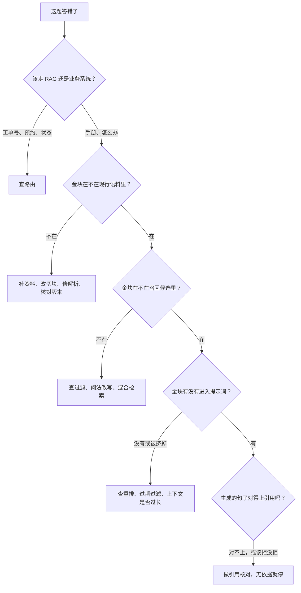

# RAG 为什么会答错：常见失败模式与排查

**FDE-21** · **2026-11-23** · Day 21 · **主题板块** LLM 应用 · **难度** 入门到进阶

## 场景：「再换一个模型就好。」
物业报修助手把上一课的链路接上了（接 [FDE-20](FDE-20-2026-11-22-LLM应用-RAG全流程切块召回重排引用.md)）：按结构切块、混合检索、重排、引用核对。用书面题演示，「厕所地台渗水，我先可以做什么？」答得干净，还标了出处。

上线几天，客服把几条投诉甩过来。「地台漏水我可唔可以关总掣？」系统说可以关大厦总阀。「sink leak 点算」给了一段供水介绍，没有应急步骤。有人问到场要多久，回答写成「24 小时内必须上门」，现行页里明明没有这个时限。还有住户丢来「WO-3184 师傅到了没？」，助手根据一份旧 FAQ 说「一般两小时内」，工单系统里其实已经改约。

有人建议换更大的模型，或把取回的片段再加一倍。演示能过、真实问法不过，多半不是模型不够大，而是链路里某一环已经断了。本课只练一件事：答错时，先定位是哪一层坏了，再决定改什么。RAG 本身见 [检索增强生成](../ai-glossary/AI-02-RAG检索增强生成(RAG).md)；模型把资料里没有的内容写进答案，是 [幻觉](../ai-glossary/AI-01-AI幻觉(Hallucination).md) 的一种落地形态。系统评测留到后面的课。

## 概念

### 先把「答错」拆开
「答错了」不是一种病。同一句错答，可能来自完全不同的环节：问题不该走 RAG，资料里没有或切坏了，对的块没被召回，召回了但没进提示词，或进了提示词但模型没用上、甚至用记忆补了一句。

排查时先选定一题，并写下「这一题应该命中的那一块」（金块）。没有金块，就只能靠感觉调参。然后按链路往下问，不要跳去换模型。

### 五类常见失败
**问错了路。** 工单号、预约、实时状态应查系统，不该进手册检索。路由错了，后面检索再准也是在错误的资料里找答案。

**资料没有，或切坏了。** 手册本来就没写；或写了，但切块把「不要关总阀」和前面的步骤切开，解析把表格弄丢，索引的是停用版。这一层的特征是：怎么搜，金块都不会出现。

**召回没找到。** 金块在库里，但不在前几十条候选中。常见原因：只拿书面标题做检索、口语或中英混杂没有改写、过滤条件把屋苑或权限滤错、只用向量没用关键词（条款号、物料型号会丢）。见 [FDE-19](FDE-19-2026-11-21-LLM应用-Embedding与向量检索原理与选型.md)。

**送错了上下文。** 金块已经在候选里，但重排没留下；或过期通知、不相干章节挤进提示词；或一次塞了几十段，关键例外夹在中间被忽略。这一层要看的是：送给模型的那几段里，有没有金块，有没有不该出现的旧条文。

**生成时没用上，或补了记忆。** 提示词里已有依据，模型却只摘了半句，或把资料里没有的时限写进去。有的回答还标了出处，但被引用的片段里并没有那句事实。看起来像引用，不等于接地。片段里没有依据时，应删句或说明手册没有，而不是换一个更会写的模型。

权限和版本过滤仍然要发生在取候选时。片段一旦进了提示词，就可能被说出来，见 [权限感知检索](../ai-glossary/AI-17-权限感知检索(Permission-aware-Retrieval).md)。

改完切块、检索或核对规则之后，要用同一批失败问法再跑一遍，包括「手册里没有、应该拒答」的题。没有这批例子，下次演示仍可能只拿会答的书面题过关。

## 香港落地例子
继续用上一课那页虚构的「渗漏应急处理（现行版）」：单元内渗水先关角阀、拍照；若可能来自公共立管，先报管理处，不要关大厦总阀；到场时限见承办商合约，本页不规定小时数。

下面四条错答，对应不同的层。排查时不要看「写得像不像」，要看金块在哪一步消失。

「地台漏水我可唔可以关总掣？」系统回答「可以，先关大厦总阀」。应命中的金块是「不要自行关闭大厦总阀」那条例外。若语料里这一条已经被切到下一块、或根本没进索引，这是资料和切块问题：先把规则和例外放回同一块，或留重叠。若金块在库里，但不在候选中，才是召回问题：用这句口语问法做改写或补已审的同义问法，而不是先加大 k。

「sink leak 点算」召回的是泛泛的供水介绍，关键的「渗漏应急」没进候选。金块在库里却找不到，是召回失败。书面标题能命中，不能证明口语和中英混杂也能命中。

有人问「非紧急报修要多久才会上门？」回答写成「24 小时内必须上门」，出处指向一张已失效的「台风后临时安排」。金块（现行页「本页不规定具体小时数」）也许在候选里，但过期通知也进了提示词，模型挑了句好听的。这是过滤和上下文的问题：失效日期要在检索时生效，不能指望模型自己判断哪张过期。若现行页进了提示词，模型仍写出 24 小时，还把现行页标成出处，那就是生成没有做引用核对——被引用的句子并不支持这个时限，应删掉这句，改口「这一页没有写到场时限，请转管理处」。

「WO-3184 师傅到了没？」若去查手册或旧 FAQ，属于问错了路。先看路由，再谈检索。

四类雇主的差异（对照即可）：

| 雇主类型 | 这件事上的侧重点 |
|----------|------------------|
| AI 原生 / 产品公司 | 失败问法和金块是带版本的回归集；改模型或切块必须先看金块在哪一层消失，而不是看演示题是否还能答对 |
| 大厂云与平台 | 要能在托管知识库里看到召回候选、过滤条件和引用是否对得上；客户要的是可排查的链路，不是只给最终答案 |
| 咨询与系统集成 | 把「答错先分段排查」和冻结失败集写进范围；工时往往花在资料、切块和过滤，而不是换模型 |
| 甲方企业内部（如银行、保险、地产） | 错答要能说明依据从哪一层丢失；无依据必须停并转人工；排查记录本身也可能被安全或合规问到 |

## 面试怎么说
**题目**（公开面经里的常见问法类型）：「上线后用户说 RAG 答错了，你怎么排查？」或「怎么减少 RAG 的幻觉？」

**答题思路**：先不要换模型。固定一题和一个金块，按路由、资料、召回、上下文、生成逐层看：金块在哪一步消失，生成的句子能不能对上引用。能演示答对，不代表失败问法和拒答题已经回归。

**可以这样说**：

> "I wouldn't start by switching models. I'd pin one failed question and the chunk that should have been hit, then walk the pipeline. First, should this even go to RAG, or to a system of record? If the gold chunk isn't in the current corpus, I fix parsing, chunking, or versioning — a rule and its exception have to stay together. If it's in the corpus but not in the retrieved candidates, I look at filters, query rewriting, and hybrid search. If it was retrieved but never made it into the prompt, I check the reranker, expired-document filters, and whether the context is too crowded. Only when the right chunk was actually in the prompt do I look at generation: every claim has to be supported by the cited text, and if it isn't, I drop the claim or refuse. A polished demo on wording that already matches the handbook is not enough; I regress the real failed questions, including cases the handbook does not cover."

用客户习惯的语言（粤语或普通话）把「先定位再改」讲完；用英文把同一套排查步骤写进方案。

## 小练习
用 15 分钟，只针对上面那页「渗漏应急处理（现行版）」和一条错答做排查设计。错答是：「地台漏水我可唔可以关总掣？」系统回答「可以，先关大厦总阀。」

写下：

1. 这一题的金块是哪一句，以及你的第一问是什么（该不该走 RAG，还是金块在不在现行语料里）。
2. 若金块在库里却不在候选中，你准备查哪三件事（过滤、问法、检索方式里任选，写具体动作）。
3. 若金块已经在提示词里，系统仍这样答，你如何收口（引用核对后删句、改口或转管理处），以及为什么这时先换模型解决不了。

写完后对照：有没有跳过「金块在哪一层消失」直接调参；有没有把「关总阀」这种危险建议，只当成文案问题。

## 一句话带走
**RAG 答错了，先找金块在哪一层消失。** 路由、资料、召回、上下文、生成，一层一层看；对不上依据就停，不要先换模型。

## 自测

1. 同事看到几条投诉后建议：立刻换一个更大的模型，并把送给模型的片段从 5 条加到 40 条，「上下文多一些、模型强一些就会稳」。这样做有什么问题？你会先做什么？
2. 你在一家咨询与系统集成公司做 FDE，客户希望「这周先微调模型，把答错压下去」。和物业报修的内部助手相比，你会把什么写进这一周的范围，什么先不承诺？

先用自己的话写两三句，再打开答案。

参考答案

**第 1 题**：更大的模型和更多片段，都补不了「金块根本不在提示词里」或「过期条文已经混进去」的问题。片段一多，关键例外更容易被挤到中间或被忽略，费用和延迟也会上升。应先固定失败题和金块，按路由、资料、召回、上下文、生成逐层看。金块不在库里就改切块或版本；不在候选里就改过滤、问法改写或混合检索；在提示词里仍写错，就做引用核对，无依据就删句或拒答。换模型和加大 k，要等定位之后，并且用同一批失败题（含应该拒答的题）回归。

**第 2 题**：咨询项目里，「先微调」很容易变成范围外的模型训练，还解决不了资料切散、过滤失效或路由错误。这一周应承诺的是：选出若干真实失败问法并标金块，分段排查并修复切块、过滤、召回或引用核对，再跑回归，包括手册没有的题必须停。微调或换模型只有在金块已进入提示词、生成仍系统性偏离时才进入讨论，并单独估时。这些要写进范围和验收，而不是口头答应「这周把准确率压下去」。

系列：上一篇 · [RAG 全流程：切块、召回、重排、引用](FDE-20-2026-11-22-LLM应用-RAG全流程切块召回重排引用.md) · 下一篇 · [工具调用：让模型提议，由程序执行](FDE-22-2026-11-24-LLM应用-工具调用Tool-calling与Function-calling.md) · [回到索引](README.md)
