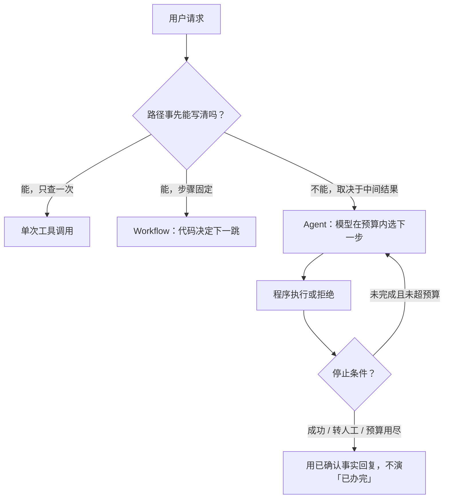

# Agent：规划、循环与记忆，以及什么时候不该用

**FDE-23** · **2026-11-25** · Day 23 · **主题板块** LLM 应用 · **难度** 入门到进阶

## 场景：「再包一层 Agent，它就能自己跟到上门。」
上一课把改约做成了工具调用：模型提议，程序执行，写入要人确认，见 [FDE-22](FDE-22-2026-11-24-LLM应用-工具调用Tool-calling与Function-calling.md)。客服又丢来一句：「这单一直拖，你当个 Agent 跟一下，能改约就改，要换师傅就换，跟到上门为止。」

演示里它连着查了状态、翻了两个档期，还起草了一封给住户的道歉信，听起来很能干。打开工单系统，预约没动，换师傅的请求也没发出去；有一次它根据对话里住户随口说的「应该好了吧」，直接回复「WO-3184 已完成」。

问题不是要不要用「Agent」这个词，而是三件事还没分清：下一步由谁决定，跨步状态存在哪，什么时候必须停。本课只练一件事：分清单次工具调用、写死路径的 workflow，和由模型在循环里选择下一步的 Agent；并先会判断什么时候不该用。术语和评测细则见 [智能体](../ai-glossary/AI-04-智能体(Agent).md)。

## 概念

### 下一步由谁决定
三种做法差在控制权，不差在「会不会调工具」。

- **单次工具调用**：路径写死。问「师傅到了没？」就查这一张单，查完回答。见 [FDE-22](FDE-22-2026-11-24-LLM应用-工具调用Tool-calling与Function-calling.md)。
- **Workflow**：步骤事先排好，由代码编排。例如改约总是先查当前单，再把「后天上午」落成可约时段，等人确认后才写入。模型只负责其中几步（理解口语、起草给确认用的摘要），不决定下一跳。
- **Agent**：目标还没完成时，模型根据上一轮的观察，在你给的工具、权限和预算里选择下一步。可以再查一次、换一个只读工具，或提议一次写入。路径不是事先画完的。

少了目标、循环、停止条件和跨步状态，就不要急着叫它 Agent。只是把系统提示改成「你是一个 Agent」，下一步仍由你口头想象，系统里不会多出一条可控的循环。



公开讨论里常把前两种叫 workflow，把第三种叫 agent，并建议先用更简单的方案：路径能画成决策树，就写在代码里，再分别打磨每一节点。Agent 适合中间结果会改写路线、分支多到写不完的任务；它不是给现有助手的默认升级。

### 规划、循环，和记忆放哪
循环很短：观察 → 选择动作 → 程序执行或拒绝 → 再观察。规划有两种常见写法：走一步看一步（想、做、看，再想）；或先列出计划再逐步执行，中途不对就改计划。前者灵活，后者更容易让人先审计划。不管哪一种，计划只是提议：没有成功的工具返回，就不能把计划里的「已改约」说出去。

跨步状态要存在程序里：已确认的事实、还缺什么、上次错误原文、是否已取得写入确认。对话历史只能当上下文，不能当工单系统的真相来源。住户说「应该好了吧」，不是结单依据；预约时间、师傅是否上门，只能来自这一次（或这一轮已成功的）系统返回。对话越长，模型越容易丢掉前面的观察，token 费用也会上去，所以不要靠「多聊几轮它就会记得」。

### 什么时候不该用，以及必须写在程序里的停法
先问两个问题：路径能不能事先写清？任务值不值得承担不确定的步数、费用和排障成本。能写清，就不要上 Agent。

- 「WO-3184 师傅到了没？」只要一次只读查询。
- 「帮我改约到后天上午」步骤固定，用 workflow：查单、落时段、确认、写入。
- 只有「这单卡住了，跟到能上门或转人工」这类请求，下一步取决于卡住的原因（师傅失约、缺配件、要另派工种、住户不在），才值得考虑 Agent。

真要上，停止条件写在程序里，不写在提示词里：目标达成（例如已有确认过的新预约）；同一错误连续两次，转人工；轮数、工具调用次数、耗时或费用触顶，预算用尽。预算用尽时，输出已确认的事实、未完成的步骤、最后一次错误原文，禁止说「已处理完毕」。写入、换师傅、对外发信，仍要人确认，门闩在代码里，见 [人工在环](../ai-glossary/AI-15-人工在环(Human-in-the-Loop).md)。没有成功读到当前单，就不能进入写入。

## 香港落地例子
继续用虚构的物业报修助手。先把三句客服原话分开，不要一律升级成 Agent。

「WO-3184 师傅到了没？」走 `lookup_work_order`，回答只用这次返回。这不是 Agent。

「帮我改约到后天上午」走固定流程：先查单，把「后天上午」落成具体可约时段，给客服确认，再调用 `reschedule_work_order`。模型可以起草确认摘要，但下一跳由代码决定。这是 workflow。

「这单卡住了，帮我跟到能上门或转人工」才可能是 Agent。先写任务卡，再让循环跑：

```
目标：在当前客服权限内，把 WO-3184 跟到「已有确认预约」或「需转人工」。
工具：lookup_work_order（只读）；list_available_slots（只读）；reschedule_work_order（写入，需确认）；add_followup_note（写入，需确认）。
禁止：结单、改承办商合约、用对话里的口头说法覆盖系统状态、承诺系统里不存在的上门时间。
停止：已有确认预约 → 成功；同一错误连续 2 次 → 转人工；超过 8 轮或 12 次工具调用 → 预算用尽。
预算用尽时：列出已确认事实、未完成步骤、最后一次错误原文。
```

一次合理的运行：先查到「师傅失约，工单仍开放」→ 列出两个上午档期 → 客服确认后改约 → 再查一次，系统已是新预约 → 停止。若第一步超时，把超时原文交回，不进入写入。若模型还没查到当前单，就想结单或改约，程序直接拒绝。若它根据「应该好了吧」准备结单，程序同样拒绝：对话记忆不是状态来源。

四类雇主的差异（对照即可）：

| 雇主类型 | 这件事上的侧重点 |
|----------|------------------|
| AI 原生 / 产品公司 | Agent 可能就是产品本身；要能说明成功率和每任务步数、费用，而不是演示里「看起来会跟」 |
| 大厂云与平台 | 平台往往已有编排和工具接入；你要帮客户判断哪些流程用 workflow 就够，哪些才值得上 Agent |
| 咨询与系统集成 | 期望容易偏高，先交一个范围很窄、能验收的循环，把停止条件、人工确认和审计写进方案 |
| 甲方企业内部（如银行、保险、地产） | 能用 workflow 解决的，通常不上 Agent；权限、确认和可回放是硬条件 |

## 面试怎么说
**题目**（公开面经里的常见问法类型）：「什么是 Agent？」或「Agent 和普通的工具调用有什么区别？」也常接着问：「什么时候不该用？」

**答题思路**：先说谁决定下一步，再主动讲不用的情形。路径能写清，就用单次调用或 workflow；真要用 Agent，目标、白名单、预算和停止条件写在程序里，状态以系统为准，写入仍要确认。

**可以这样说**：

> "I don't start with an agent. If the path is known — look up a work order, or reschedule after a confirmed slot — I use a single tool call or a workflow in code. That's cheaper, easier to test, and the next step isn't left to the model. I only use an agent when the next action really depends on intermediate results, like chasing a stuck ticket until we have a confirmed appointment or a human handoff. Even then, the goal, the tool whitelist, the budget, and the stop conditions live in the application, not in the prompt. Cross-step state is confirmed facts from the system, not from chat memory. Reads can loop. Writes still wait for confirmation, same as in tool calling. If the budget runs out, I report what is confirmed and what is left — I never tell the user it's done."

用客户习惯的语言（粤语或普通话）先讲「这里不必上 Agent」；用英文把控制权和停止条件写进方案。

## 小练习
用 15 分钟，只针对物业报修助手，写下：

1. 把「师傅到了没？」「改约到后天上午」「这单卡住了，跟到能上门或转人工」分别标成：单次工具调用、workflow，还是 Agent。各用一句话说明为什么。
2. 若第三句真的上 Agent：目标怎么写，哪些工具只读、哪些要确认，预算和停止条件是什么。
3. 状态里哪几项必须存在程序里（而不是只靠对话历史）；若模型根据「应该好了吧」请求结单，程序应如何拒绝。

写完后对照：有没有把系统提示里的「你是 Agent」当成已经接上了循环；有没有让对话记忆覆盖工单系统。

## 一句话带走
**路径能写清，就不要上 Agent。** 真要用，目标、预算和停止条件写在程序里；状态以系统为准，预算用尽也不能说「已办完」。

## 自测

1. 演示里这个「Agent」根据住户在对话里说的「应该好了吧」，回复「WO-3184 已完成」。工单系统里状态仍是待上门，也没有一次成功的结单调用。这是什么问题？你会先改哪一层，而不是先换模型或再加工具？
2. 你在一家大厂云与平台做 FDE，客户希望「把现有的物业助手整周升级成 Agent，什么都能自动跟」。和本课的报修助手相比，这一周你承诺什么、不承诺什么？

先用自己的话写两三句，再打开答案。

<details>
<summary>参考答案</summary>

**第 1 题**：它把对话记忆当成了工单真相，又在没有成功调用的情况下把「已完成」发给了用户。这不是模型不够大，也不是工具太少。先改执行层和状态来源：结单或改约必须经过程序，且只能依据系统返回；对话里的口头说法不能覆盖状态。没有成功写入（这里甚至不该允许结单工具在未读到「已完工」依据时出现），就拦截这句，改口说明系统里仍是待上门。换模型或再给它一个「智能结单」工具，补不了「循环没有停止条件、状态没有落在程序里」的问题。

**第 2 题**：平台这边很容易把「升级成 Agent」理解成默认开通自动循环。这一周应先盘点现有路径：查状态、确认后改约这类写得清的流程，保持单次调用或 workflow，不整包升级。只对「卡住了要跟到上门或转人工」这类取决于中间结果的任务，做一个范围很窄的试点：工具白名单、轮次和费用预算、写入确认、每步可回放。验收看任务是否真的到达确认预约或转人工，以及有没有越权写入，而不是演示里会不会连续说话。不承诺「什么都能自动跟」，也不在这一周放开结单、换商或对外发信的自动执行。

</details>

## 延伸观看
- [How We Build Effective Agents](https://www.youtube.com/watch?v=D7_ipDqhtwk)（Barry Zhang，Anthropic，AI Engineer Summit）：约 15 分钟，核心是「不要什么都做成 Agent」，以及路径能写清时先用 workflow。

系列：上一篇 · [工具调用：让模型提议，由程序执行](FDE-22-2026-11-24-LLM应用-工具调用Tool-calling与Function-calling.md) · [回到索引](README.md)
