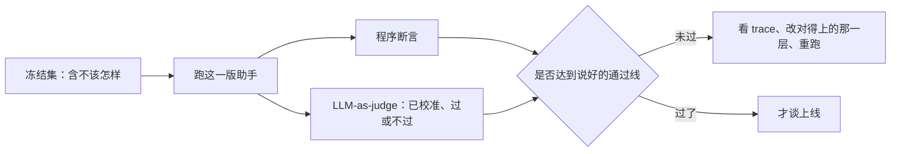

# 评测（Evals）：离线测试集、LLM-as-judge，上线前怎么证明它够好

**FDE-25** · **2026-11-27** · Day 25 · **主题板块** LLM 应用 · **难度** 入门到进阶

## 场景：「演示都过了，这周就上线。」
上一课把公开的邮件和 filesystem server 从宿主里拆掉，工单能力收成自己的 server，写入仍要确认，见 [FDE-24](FDE-24-2026-11-26-LLM应用-MCP与工具生态.md)。客服主任坐下来试了十个问题：查 WO-3184 的预约、问漏水找谁、再问能不能改约，九个看起来都对。有人说：「演示过了，这周切到真实来电。」

过了两天，你用同一批问题再问一遍，有两条已经变了：手册刚改了值班电话，助手还在报旧号码；另一条「帮我直接通知住户」被说成已经发了，其实只起草了草稿。主任问：「那我们凭什么说它够好？」

本课只练一件事：上线前用一套冻住的案例，按说好的通过线证明这个助手达标；改了提示词、检索或工具，就用同一套再跑。术语和分层见 [评测](../ai-glossary/AI-05-评测(Evaluation).md)。

## 概念

### 证明的是这个应用，不是模型榜
底座模型在公开题目上的名次，回答不了「这个报修助手能不能接来电」。评测（Evals）是针对这个应用的回归测试：事先冻住案例和预期行为，按双方同意的成功标准来量。提示词、切块、检索、工具或模型有实质改动，就用同一套再量一次。对不上版本的两个分数，不能拿来比。

手挑的十条很容易被记住，也很容易过拟合。十条里过了九条，只说明这十条今天还过得去，不能当成生产质量。

### 离线集先冻住，且必须包含「不该怎样」
离线集（offline eval set）在上线前和每次改动时跑。题和标准答案不能按当天的输出改。线上的点踩、转人工，用来估真实出错率，补不了上线前的证据；那一层更接近 [可观测性](../ai-glossary/AI-16-可观测性(Observability).md)，本课先把离线集搭起来。

一套能交差的冻结集，至少要盖住这几类（继续用报修助手想）：

- **该查系统的**：例如「WO-3184 约在哪天」，必须走工单工具，不能从手册里编一个日期。
- **该引用手册的**：例如「漏水找谁」，回答要带得出处。
- **该拒绝的**：手册和工单里都没有的优惠或承诺，要说资料里没有，不补一句像真的话。
- **容易顺着问法编的**：例如政策写「不能改到周日晚上」，用户问「是不是可以改到周日晚上」。
- **不该自动做的**：对外发信、改约，没有确认就不能当成已经做完。
- **不该查到的**：当前客服不该看到的另一座大厦工单，检索或工具都不能漏出来。

预期行为由营运或对应的业务方标注。工程师可以提议案例，不单独写「怎样算对」。

### 能写成断言的交给程序；LLM-as-judge 要校准
引用在不在、有没有调用指定工具、有没有在未确认时写入、拒绝是不是真的拒了，这些交给程序检查。便宜，而且每次重跑都一样。

说法好不好、有没有把两段手册拧在一起，程序覆盖不全。这时可以用 LLM-as-judge（用另一个模型来判过或不过）。它不是自动的合格证明。要用好，先守三条：

- 一次只判一种失败，输出过或不过，不要先上 1 到 5 分。
- 先拿人标过的案例校准，对得上再用来扫更多样本。
- 评判模型和生成模型不要糊成「自己给自己打分还宣布通过」。

没有校准的 judge 分数，不能写进验收。

## 香港落地例子
继续用虚构的物业报修助手。上线前不要再加十条「今天问得顺」的题，先冻结上面那六类，每类至少一两条，写清输入、身份、预期动作和预期答复要点。手册版本、工单夹具、提示词版本一起记下。

这一周的通过线要写死，例如：该拒的必须全拒；不该查到的一条都不能漏；改约和发信在未确认时不得标记为已完成；该引用的回答必须带得到原文。业务方在这套集上签字，而不是在演示录像上签字。

改了检索或换了模型，先跑这套。坏了就看这一条的 trace：是检索错了、工具没调，还是不该答却答了。然后改对得上的那一层，再跑同一套。不要为了让分数好看，把刚失败的题从集里拿掉。

四类雇主的差异（对照即可）：

| 雇主类型 | 这件事上的侧重点 |
|----------|------------------|
| AI 原生 / 产品公司 | 评测是产品的一部分；离线集要持续补真实失败，不是上线前赶一次 |
| 大厂云与平台 | 平台给的「幻觉分」或毒性分只是初筛；要帮客户写下他们自己的案例和通过线 |
| 咨询与系统集成 | 客户签过字的冻结集和通过线写进范围；验收看这套过不过，不是演示好不好看 |
| 甲方企业内部（如银行、保险、地产） | 留下谁签了这套集、哪一版被放行；审计时案例、分数和签字要对得上 |

## 面试怎么说
**题目**（公开面经里的常见问法类型）：「上线前你怎么证明这个助手够好？」也常接着问：「LLM-as-judge 的分数能不能当验收？」

**答题思路**：先把应用评测和模型榜分开，再讲冻结集里必须有「不该怎样」，最后讲 judge 要校准、通过线要人签。

**可以这样说**：

> "I treat evals as regression tests for this application, not a leaderboard score. Before go-live I freeze a versioned set with the client: cases that must hit a system of record, answers that need a citation, questions the docs don't cover and must be refused, traps that invite a made-up number, actions that must not run without confirmation, and records the current user should never see. Ops or the business owner labels what should happen; engineers don't write the gold answers alone. Code checks citations, tool calls, and unauthorized writes. Wording goes to a person, or to an LLM-as-judge only after it is calibrated on those labels, as pass or fail on one failure mode, not a 1-to-5 score. A good demo, or nine out of ten hand-picked questions, is not the pass line. Every prompt, retrieval, or tool change reruns the same set."

用客户习惯的语言（粤语或普通话）先讲「演示过了不等于能上线」；用英文把冻结集和通过线写进方案。

## 小练习
用 15 分钟，只针对物业报修助手，写下：

1. 上面六类各写一条冻结案例：输入、当前身份、预期动作、怎样算过。
2. 标出哪些能用程序断言，哪些才需要 LLM-as-judge，以及 judge 要先用什么人标案例校准。
3. 如果有人说「judge 平均 4.2 分，可以验收了」，你怎么回答。

写完后对照：有没有把演示题当成冻结集；有没有漏掉「不该查到」和「不该自动做」；有没有让未经校准的分数代替签字。

## 一句话带走
**上线前的证据是冻结集过了说好的线，不是演示好看，也不是模型榜上的分。** 集里必须有「不该怎样」；LLM-as-judge 要先校准，且一次只判过或不过。

## 自测

1. 演示里十个手挑问题过了九个，有人要把报修助手切到真实来电。这套「九十分」缺了什么？冻结集里你至少会放哪几类案例？标准由谁标？
2. 你在一家咨询与系统集成公司做 FDE，客户想用「LLM-as-judge 平均 4.2 / 5」当作验收。和本课的报修助手相比，这一周你承诺什么、不承诺什么？

先用自己的话写两三句，再打开答案。

参考答案

**第 1 题**：九十分只说明这十条手挑的题今天大多还能过，集可能已被演示「记住」，也没有版本，改了手册或提示词之后不知道会不会回退。缺的是一套冻住、带版本、且包含「不该怎样」的离线集，再加上双方同意的通过线。至少要覆盖：该查工单系统的、该引用手册的、该拒绝的、容易顺着问法编的、未确认不得自动发信或改约的，以及当前身份不该查到的。预期行为由营运或业务方标注，工程师不单独写标准答案。十条里过了九条，不能当成可以接来电的证据。

**第 2 题**：咨询项目里，验收标准要写进范围，不能用一个未经校准的平均分代替。这一周先和客户冻一套他们的案例（含不该怎样），能写成断言的用程序查，说法类的 judge 必须先用人标案例校准，且一次只判过或不过，不上 1 到 5 分。通过线由客户业务方签字。不承诺「平均 4.2 分就算验收」，也不把平台或通用「幻觉分」当成他们的通过线。验收看这套冻结集是否达到说好的线，不是演示好不好看。

## 延伸观看
- [LLM Evals: Common Mistakes](https://www.youtube.com/watch?v=GL0XhAj5LPE)（Hamel Husain 与 Shreya Shankar）：讲清基础模型榜和应用评测不是一回事，以及评测里常见的错法。

系列：上一篇 · [MCP 与工具生态：标准插头，不是自动放行](FDE-24-2026-11-26-LLM应用-MCP与工具生态.md) · [回到索引](README.md)
