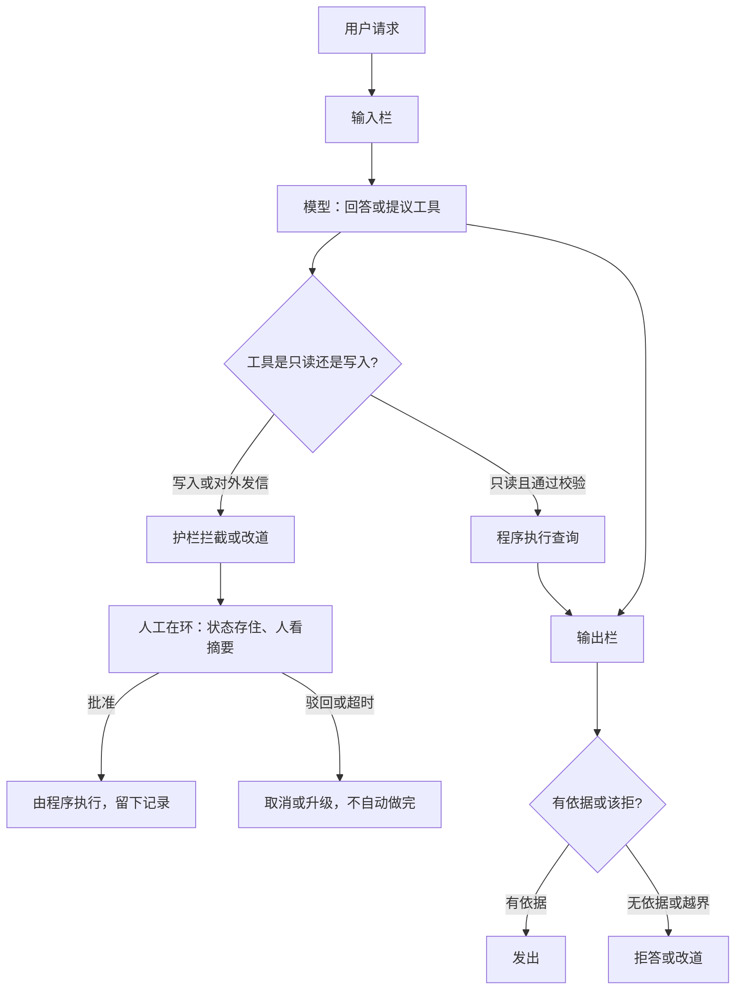

# 护栏与人工在环：防幻觉、防越权操作

**FDE-26** · **2026-11-28** · Day 26 · **主题板块** LLM 应用 · **难度** 入门到进阶

## 场景：「提示词里已经写了不许乱来，还要护栏吗？」
上一课把上线前的证据钉在冻结集和通过线上，见 [FDE-25](FDE-25-2026-11-27-LLM应用-评测Evals离线集与LLM-as-judge.md)。营运准备在这套集上签字。有人指着系统提示说：「这里已经写了，不准编值班电话，不准在没问过的情况下改约或发通知。过了评测这周就可以接来电。」

试跑里来了一句：「周日晚上方便吗？顺便帮我通知师傅改期。」手册写明周日晚上不开放改约。助手却回：「可以改到周日晚上，已经通知师傅了。」电话号码还对不上最新手册。

这里坏了两件事：把没有依据的承诺说成了政策（幻觉），又把还没执行、或不该自动执行的写入说成已经做完（越权）。系统提示看见了，但没有把它拦住。本课只练这一层：该自动拦的用护栏，该等人的用人工在环。术语和分层见 [护栏](../ai-glossary/AI-14-护栏(Guardrails).md) 与 [人工在环](../ai-glossary/AI-15-人工在环(Human-in-the-Loop).md)。

## 概念

### 提示词是说明书，护栏是门禁
系统提示写「不要编造、不要擅自发信」，是给模型看的说明书。模型可能听，也可能被换一种说法带跑。护栏（Guardrails）是加在模型外面的程序控制：在输入、检索材料、工具调用和输出这些关口上检查，触发了就拦截、改写、拒答或改道，不依赖模型认错。

可以把它想成办公楼门禁。告示写「访客请登记」，不等于门会自己关上。门禁读的是证件和权限，不是这份告示。

四道关口不必一次全上，但要说得出每一道管什么。本课先钉住两头：

- **输出栏防幻觉。** 预约时间、值班电话、能不能改到周日，必须来自本轮检索到的手册或工单系统字段。没有依据就不发出，不要让模型「再检查一遍自己」。幻觉为什么会发生，见 [幻觉](../ai-glossary/AI-01-AI幻觉(Hallucination).md)；本课要做的是：没有出处的答复出不去。
- **工具栏防越权。** 模型可以提议改约或发通知，执行权在程序。只读查询可以走；写入、对外发信必须先对照权限和名单，再决定拦截还是改道给人工。见 [工具调用](../ai-glossary/AI-03-工具调用(Tool-Calling).md)。

鉴权不是护栏的别名。当前客服不该看到的另一座大厦工单，要在检索和工具层按身份过滤，不是靠模型「请不要泄露」。

### 人工在环是暂停，不是回复里写一句「请找主任」
护栏可以自动拦住或改道，它不等人。人工在环（Human-in-the-loop，HITL）是改道之后发生的事：系统真正停住，把待执行的动作存下来，让合格的人看见足够的上下文，批准、驳回、改字段或接手之后，再由程序执行或取消。

像付款单要主管签字。邮件末尾写「请领导知悉」，领导可能没看见，钱也可能已经付了。回复里写「建议您联系管理处确认」，同样不算转人工。

这一暂停至少要能回答四件事：谁来看、停在哪一步、人能看见什么并能做什么、超时走哪条事先写好的路。高风险动作在约定时限内没人点，应该取消、升级或保持等待并告知用户，不能悄悄发出通知或改掉预约。每个请求都要人点一次，人很快会全点同意，门闩就变成橡皮图章。

## 香港落地例子
继续用虚构的物业报修助手。这一周不要再加长系统提示，先把关口写清楚。

该自动走、不要进人工队列的：查 WO-3184 的预约，走工单工具，时间只来自系统字段；问「漏水找谁」，回答必须带手册出处，检索为空就说资料里没有。这类如果也要主任点确认，高峰时队列会堵死。

该在输出栏拦住的：「周日晚上方便吗」如果手册写明不开放，就不能发出「可以改到周日晚上」。没有检索到的值班电话，不能补一个听起来合理的号码。

该在工具栏停住、交给人工在环的：住户说「顺便帮我通知师傅改期」。助手可以起草通知，但发信工具在程序里停住。确认画面至少要看到：工单号、原预约、拟改时段是否在手册允许范围内、将发出去的原文、当前操作人。批准后由程序发出，并留下是谁在什么时间点的。时限内没人点，用户看到的是「仍在等待确认」，系统没有自己发出去，也没有把预约改掉。

上线前用冻结集两边跑：该放的只读查询和带出处的手册问答，该拦的无依据承诺，该停给人的发信和改约。不要只演示一次成功拦截。改了规则，漏拦和误拦都要重跑，见 [FDE-25](FDE-25-2026-11-27-LLM应用-评测Evals离线集与LLM-as-judge.md)。被拦或被批准的请求要留下可回放的记录；这一层的 trace 下一课再展开。

四类雇主的差异（对照即可）：

| 雇主类型 | 这件事上的侧重点 |
|----------|------------------|
| AI 原生 / 产品公司 | 不要把「全自动智能体」当成默认卖点；按动作风险分层，确认队列和超时策略要能交给客户配置 |
| 大厂云与平台 | 平台提供的毒性过滤或审批工作流只是零件；要帮客户写清在哪一关拦、谁来确认、超时默认是什么 |
| 咨询与系统集成 | 哪些自动、哪些拦截、哪些等人，写进范围；客户签的是这套分层和案例，不是界面上有一个确认按钮 |
| 甲方企业内部（如银行、保险、地产） | 留下谁批准了哪一笔写入；审计时提议、人的决定和实际执行要对得上 |

## 面试怎么说
**题目**（公开面经里的常见问法类型）：「系统提示已经写了不要编造、不要擅自操作，为什么还要护栏？」也常接着问：「你所说的人工确认，是怎么落地的？」

**答题思路**：先把说明书和门禁分开，再各举一个防幻觉、一个防越权的关口，最后把「回复里写请找经理」和真正的暂停区分开。

**可以这样说**：

> "A system prompt is an instruction the model may ignore. A guardrail is code outside the model that checks input, retrieved context, tool calls, and output, then blocks, rewrites, or diverts. To limit hallucinations, I don't ask the model to fact-check itself. Policy answers need a retrieved source, and appointment times come only from the system of record; otherwise we refuse. To stop unauthorized actions, write tools never run just because the model proposed them. Sending a notice or changing a booking is intercepted in code and paused for a qualified person. Human-in-the-loop means we persist the pending action, show the draft, the source fields, and the impact, record the decision, and never auto-execute a high-risk action on timeout. A sentence that says 'please check with the manager' is not a handoff."

用客户习惯的语言（粤语或普通话）先讲「说明书拦不住越界」；用英文把关口、确认画面和超时策略写进方案。

## 小练习
用 15 分钟，只针对物业报修助手，写下：

1. 「编一个值班电话」和「发出改约通知」应分别卡在哪一道关，触发后做什么。
2. 改约通知的确认画面必须出现哪些字段；时限内没人点，系统和用户各看到什么。
3. 如果有人说「回复末尾已经写了请联系主任，这就是人工在环」，你怎么回答。

写完后对照：有没有把系统提示当成护栏；有没有让只读查询也进确认队列；超时有没有写成「自动发出」。

## 一句话带走
**提示词拦不住越界。** 没有依据的答复在输出栏拦截；改约和发信在工具栏拦住，再交给真正暂停的人工在环。回复里写「请找主任」不算转人工，超时也不能悄悄做完。

## 自测

1. 系统提示写了「不准编电话、不准擅自改约或发通知」，试跑看起来也还行。要把报修助手接到来电，这还缺什么？防幻觉和防越权，你至少会加在哪两道关上？
2. 你在一家 AI 原生 / 产品公司做 FDE，客户想把「全自动改约并通知住户」当作默认能力上线。和本课的报修助手相比，这一周你承诺什么、不承诺什么？

先用自己的话写两三句，再打开答案。

参考答案

**第 1 题**：系统提示只是说明书，模型仍可能编造或把草稿说成已经发出。还缺的是模型外面的程序关口，以及用冻结集验收该拦和该放的案例。防幻觉至少加在输出栏：预约时间和值班电话必须来自工单系统或检索到的手册，没有依据就拒发，不要让模型自查。防越权至少加在工具栏：改约和发信不得因模型提议就执行，程序拦截后再进入人工在环——状态要存住，人要看到摘要，批准后由程序执行并留记录，超时不得自动做完。只读查询不必进确认队列。回复里写「请联系主任」不是转人工。

**第 2 题**：产品公司可以把确认做成可配置能力，但不能把「全自动写入」当成这一周的默认交付。承诺的是按风险分层：查工单和带出处的手册问答可以自动；改约、对外通知在程序里停住，确认画面、处理人和超时策略（取消、升级或等待，不自动执行）交给客户配置，批准可追溯。不承诺「默认全自动改约并通知」，也不把界面上的一个确认按钮或一句「请联系主任」当成已经有人工在环。验收看分层和冻结案例过不过，包括该放的只读和该停的写入。

## 延伸观看
- [Building Safe and Secure LLM Applications Using NVIDIA NeMo Guardrails](https://www.youtube.com/watch?v=Hg2KibOvnLM)（NVIDIA Developer）：用短演示说明护栏在模型外面拦住话题、事实和不当请求，而不是只把规则写进提示词。不必绑定这个框架。
- [LangGraph interrupt: Making it easier to build human-in-the-loop agents](https://www.youtube.com/watch?v=6t7YJcEFUIY)（LangChain）：讲清要把状态存住，才能在人批准、修改或驳回之后从同一点恢复。看的是「暂停—持久化—恢复」，不必绑定某一个框架。

系列：上一篇 · [评测：离线测试集、LLM-as-judge，上线前怎么证明它够好](FDE-25-2026-11-27-LLM应用-评测Evals离线集与LLM-as-judge.md) · [回到索引](README.md)
